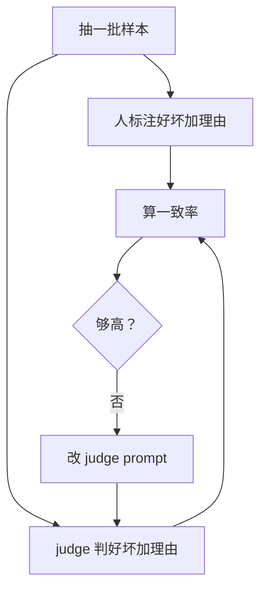

## Q
**让 judge 对齐人类 · agreement rate**｜实践 · 必会

你写了一个 LLM judge，怎么知道它判得和人一致？一致率要多高才算可用？

## A
**做法：** 让 judge 和人**在同一批样本上各判一遍**，比较。

1. 人先标注每条样本好 / 坏，并写下**理由**（critique）；
2. judge（建议用你负担得起的**最强模型**）也给判断和理由；
3. 算 **agreement rate**（判断相同的比例）；
4. 看分歧的样本，**改 judge 的 prompt** 并重测，直到对齐；
5. 上线后**定期**再抽样核对。

**参照数字（Zheng et al., 2023，MT-Bench）：** GPT-4 与人的一致率 85%，高于人与人之间的 81%。所以：**一致率应和"人与人的一致率"比**，而不是要求 100%（OpenAI 的标注员排序一致率也只有 73%）。

**别忘了：** 评测流程自己也要被评：
- 更好的回答是否真的得高分？
- 重复跑是否得到类似结果（可复现、方差小）？
- 记录 judge 用的数据、评分标准、prompt、采样参数。

出处

Hamel Husain《Your AI Product Needs Evals》（LLM-as-judge alignment）；Huyen《AI Engineering》ch3 §Why AI as a Judge?（85% / 81%）、ch4 §Evaluate your evaluation pipeline；ch2 §Preference Finetuning（73%）

