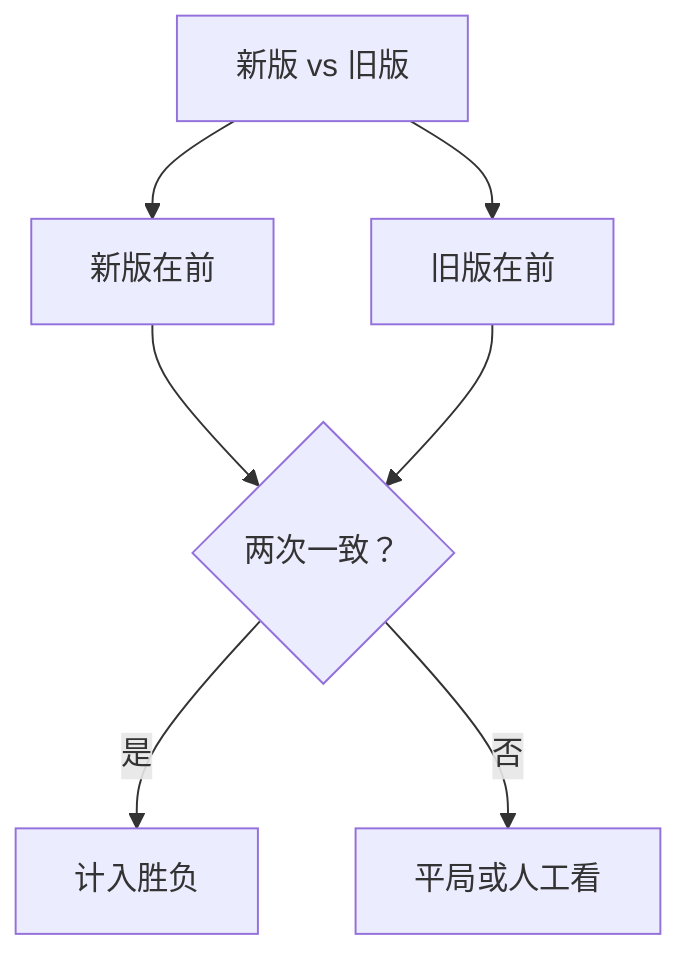

## Q
**LLM-as-judge 的 bias**｜考点 · 必会

你用 pairwise LLM-as-judge 比较新旧两版 prompt，新版"赢了 62%"。在相信这个数之前，你要排除哪三种 judge 自己的偏差？怎么排除？

## A
| Bias | 表现 | 证据 | 怎么排除 |
|---|---|---|---|
| **Self-bias** | judge 偏爱自己生成的回答 | Zheng et al. 2023：GPT-4 给自己的胜率高约 10%，Claude-v1 高约 25% | judge 不要和被评的 model 是同一个 |
| **First-position bias** | pairwise 时偏爱排在前面的那个 | 同上；人类正相反，偏爱最后看到的（recency bias） | A/B 顺序各评一次，只算两次结论一致的 |
| **Verbosity bias** | 偏爱更长的回答，不管对不对 | Wu & Aji 2023：GPT-4 和 Claude-1 都更偏爱约 100 词但有事实错误的回答，而不是约 50 词但正确的 | 在标准里写明"长度不加分"，或比较前控制长度 |

**还要检查的两件事：**
- **judge 有没有变：** 这个月和上个月的 judge model、prompt 是否完全一样？不一样，62% 和上次的数就不能比。
- **一致性：** 同样的输入跑两次，分数一样吗？Zheng et al. 2023 发现在 prompt 里加评分示例，GPT-4 的一致性从 65% 升到 77.5%，但一致不等于正确。

出处

Huyen《AI Engineering》ch3 §Limitations of AI as a judge（Inconsistency、Biases of AI as a judge）

