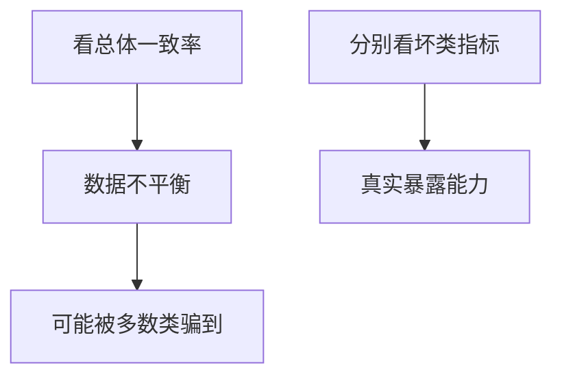

## Q
**让 judge 对齐人类 · 不平衡数据上的一致率陷阱**｜考点 · 必会

你的应用只有约 5% 的回答是坏的。你在 100 条样本上测试 judge：它对每一条都判"好"。一致率是多少？这个 judge 有用吗？应该看什么指标？

## A
**算：** 100 条里 95 条人判"好"、5 条人判"坏"。judge 全判"好"：
- **agreement rate = 95/100 = 95%**，看上去很高；
- 但 5 条真正的坏回答，**一条都没抓到**。

**这就是为什么总体一致率会骗人：** 样本不平衡时，"永远猜多数类"也能得高分。

**要分开看 precision 和 recall（把"坏"当作要抓的类）：**

| 指标 | 问 | 回到题目 |
|---|---|---|
| **Recall（抓到率）** | 真正坏的里，judge 抓到多少 | 0/5 = **0%** |
| **Precision（准确率）** | judge 说坏的里，真的坏有多少 | judge 没说过坏，无定义 |

**怎么做：**
- 给 judge 建**自己的测试集**，并刻意放进足够多的坏样本（不要按线上比例）；
- 分别报告 precision 和 recall；
- 按用途选：**拦截坏回答**更看重 recall，**不想误杀好回答**更看重 precision。

出处

Hamel Husain《Your AI Product Needs Evals》（with imbalanced classes, raw agreement is misleading; measure precision and recall separately）。95/100 的数字为出题用的例子

