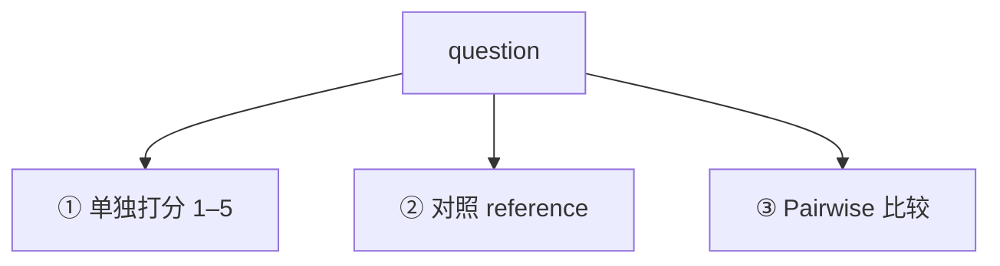

## Q
**LLM-as-judge · 摘要**｜摘要 · 必会

你的客服机器人每天回答上万个问题，没法每条都请人看。用另一个 LLM 来打分，有哪三种基本用法？各适合什么场景？

## A
**一句话：** 让一个 model（judge）按你写的标准，给另一个 model 的输出打分或做比较。

| 用法 | 需要什么 | 适合 |
|---|---|---|
| ① 单独打分 | 只要 question 和 answer | 线上监控、没有标准答案的开放问题 |
| ② 对照 reference | 一份标准答案 | 有确定答案的任务，比如事实问答 |
| ③ Pairwise 比较 | 两个候选 answer | 比较两个 model 或两版 prompt 谁更好 |

- **为什么流行：** 比人便宜、快，还能顺带给出打分理由。
- **最大的前提：** judge 本身也是一个 AI 应用，它的 model 和 prompt 一变，分数就不可比了（见考点卡）。

**出处：** Huyen《AI Engineering》ch3 §AI as a Judge · How to use AI as a judge
