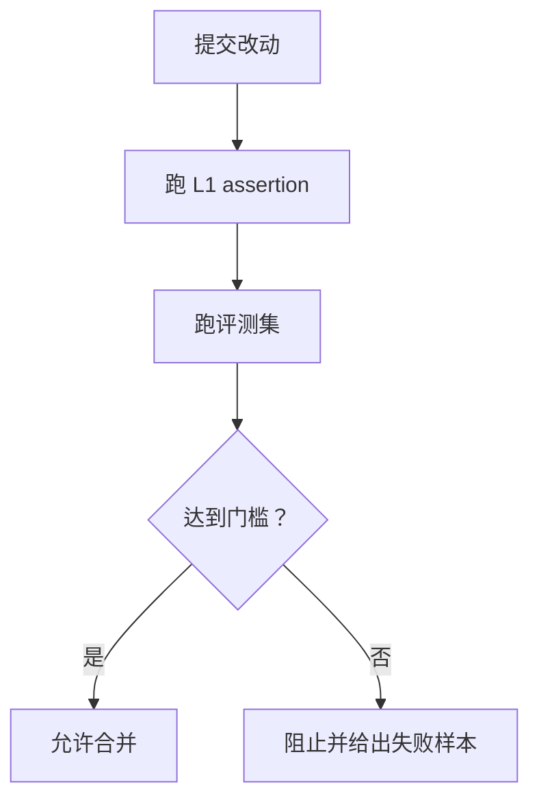

## Q
**Regression tests 与 CI gate · 怎么设**｜实践 · 必会

团队每次改 prompt、换模型、改检索参数，都想先自动跑一遍评测，不达标就不合并。这个 CI gate 怎么设？通过阈值谁来定？

## A
**什么时候跑：** **任何**会改变输出的改动：prompt、模型版本、检索（chunking、embedding、k）、sampling 参数、tool 描述。

**分层：**
| 阶段 | 内容 | 时间 |
|---|---|---|
| 每次提交 | L1 代码断言、一小批关键样本 | 秒到分钟 |
| 合并前 | 完整评测集 + judge | 较久 |
| 定期 | 大规模、成本高的评测 | 夜间 |

**阈值是产品决定，不是技术决定：** 把评测指标映射到业务指标，才知道"够不够"。书里的例子：事实一致率 80% 对应能自动化 30% 的客服请求，90% 对应 50%，98% 对应 90%；先定 **usefulness threshold（可用门槛）**，低于它就不可用。

**实践细节：**
- 把每次评测的数据、评分标准、judge 的 prompt 与参数一起记录；
- gate 失败时输出**具体失败的样本**，方便调试；
- 把新发现的线上失败加进回归集；
- 对关键标准（如安全）设**硬门槛**，对质量类指标设**不得低于基线多少**。

出处

Huyen《AI Engineering》ch4 §Tie evaluation metrics to business metrics、§Iterate（experiment tracking）。CI 集成的具体做法书里无，为通用工程实践

