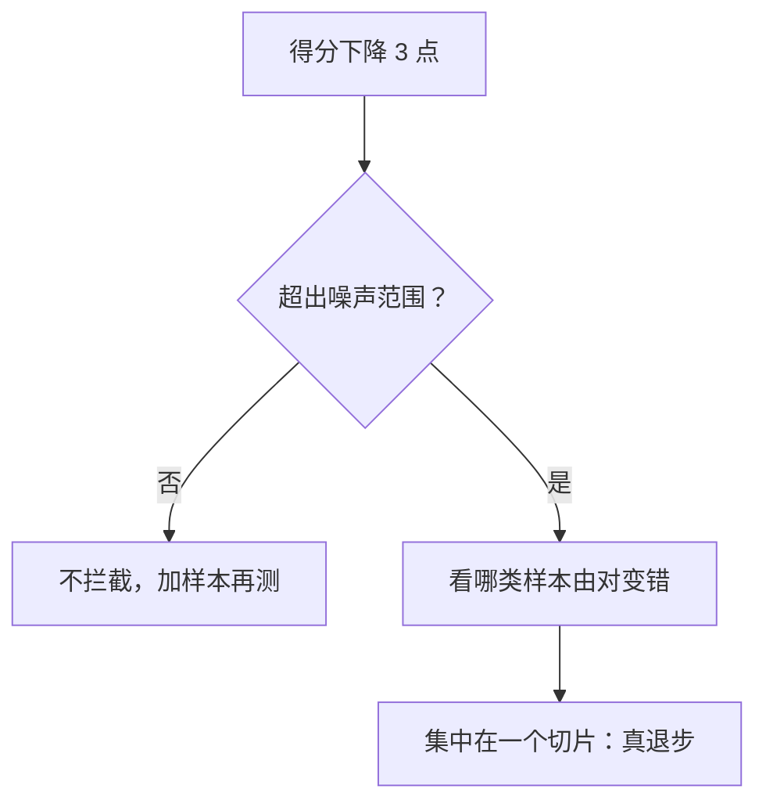

## Q
**Regression tests · 噪声下怎么判"真退步"**｜考点 · 必会

回归集 200 条，旧版得分 82%，新版 79%。CI 红了。要不要打回？

## A
**先判断 3 个百分点是不是噪声。**
- 按 OpenAI 的粗略估计，要 95% 把握分辨 **3% 的差距，约需 1,000 条样本**；200 条能分辨的差距约在 10% 以上；
- 所以这次下降**不能确认是真退步**，也**不能确认没退步**。

**可行做法：**
1. **bootstrap**：对 200 条有放回抽样多次，看得分波动范围。如果波动本身是 ±5%，3% 就在噪声里；
2. **看每条样本，不只看总分**：哪些由对变错、哪些由错变对？如果由对变错的**集中在同一类**（某个切片），那是真问题；
3. **加样本**：把可疑的切片扩大到足够的条数再测；
4. **judge 要稳定**：judge 自己也有随机性，temperature 设 0、固定 prompt，必要时同一条跑多次；
5. **关键标准用硬门槛，其余用"不低于基线减一个误差范围"。**

**别忘了：** 评测集越大，越能抓住小的退步，但跑得越贵；这个取舍要由改动风险决定。

出处

Huyen《AI Engineering》ch4 §Annotate evaluation data（Table 4-7、bootstrap）、§Evaluate your evaluation pipeline（temperature 0、variance）

