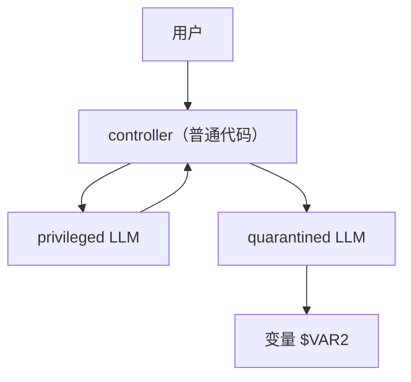

## Q
**Architectural defence · dual-LLM、plan-then-execute、capability**｜摘要 · 追问

邮件助手既要读不可信邮件，又能发邮件、查日历。检测手段不可靠，怎么在架构上保证邮件里的恶意指令改不了它的行为？

## A
**思路：** 不再指望模型分得清指令和数据，而是让**不可信数据碰不到有权限的模型**。

**1. Dual-LLM pattern（Willison 2023）：**

| 角色 | 能做 | 不能做 |
|---|---|---|
| privileged LLM | 读用户指令，调用工具（发邮件、改日历） | 从不看不可信内容，只看到变量名（如 `$VAR1`） |
| quarantined LLM | 处理不可信内容（总结邮件） | 没有任何工具；它的输出不会被送回 privileged LLM |
| controller | 普通软件：存变量、执行动作、把结果显示给用户 | |

**2. plan-then-execute：** 先由受信模型根据**用户的**请求生成计划（控制流），之后不可信数据只能填入数据位，不能改变计划。

**3. CaMeL（Google DeepMind 2025）：** 在 LLM 外加一层保护：把控制流和数据流从受信的用户请求里抽出来，使 LLM 取回的不可信数据无法改变程序流；再用 **capabilities**（附在数据上的权限标签，即 capability token）在每次调用工具时执行安全策略。在 AgentDojo 上，它以「可证明安全」解出 77% 的任务，无防御的系统是 84%。

**代价：**
- 实现复杂，用户体验受影响（Willison 自己评价 dual-LLM「相当糟」）；
- 功能受限：不能让 privileged 模型直接读邮件内容后再决策；
- CaMeL 的安全性来自解释器和策略，不来自模型本身。

**出处：** Willison《The Dual LLM pattern》simonwillison.net/2023/Apr/25/dual-llm-pattern/；Debenedetti 等《Defeating Prompt Injections by Design》arxiv.org/abs/2503.18813（均 2026-11-21 读）
