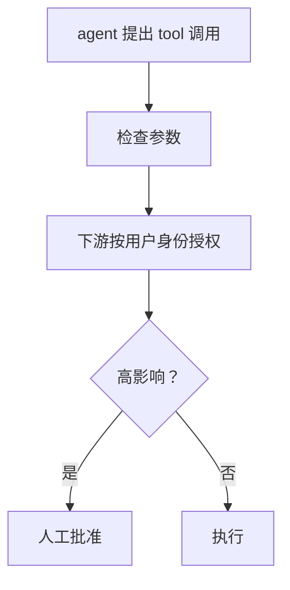

## Q
**Excessive agency · 给一个客服 agent 审权限**｜考点 · 必会

客服 agent 有三个 tool：`query_order`（查订单）、`run_sql`（执行任意 SQL）、`send_email`（发邮件给任意地址）。后端用一个 admin 数据库账号。请逐条指出问题并改。

## A
| 现状 | 问题 | 改法 |
|---|---|---|
| `run_sql` 任意 SQL | **功能过多**，开放式 tool | 换成粒度细的 tool：`get_order(order_id)`、`list_orders(user)`；参数化查询 |
| admin 数据库账号 | **权限过大**，注入可以删库 | 每个 tool 用**专门的只读账号**；写操作单独的账号 |
| `send_email` 发给任意地址 | 对外通信，数据外泄通道 | 只能发给**当前用户已验证的邮箱**，或走人工确认 |
| 查谁的订单没限制 | 没有按用户身份授权 | **以当前用户的身份**调用下游；下游检查"该用户只能看自己的订单" |
| 没有确认 | **自主性过大** | 退款、删除、发信这类动作需要人工批准 |

**原则：** 不要指望"模型自己不会这么做"。能力和权限的上限由**代码和下游系统**决定，模型的判断不是安全边界。

出处

OWASP LLM06:2025 Excessive Agency（root causes 与 mitigations）；Huyen《AI Engineering》ch5 §System-level defense（高影响 SQL 需人工批准）

