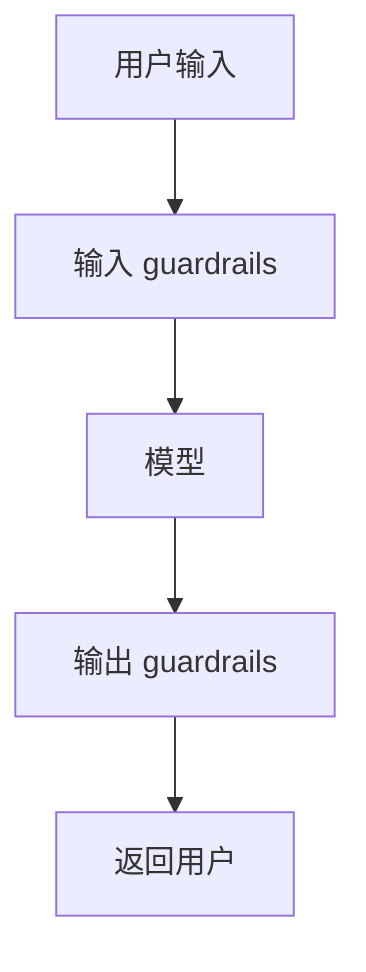

## Q
**Input/output guardrails · 分层**｜摘要 · 必会

给一个调用外部 model API 的应用加 guardrails。输入端和输出端各要拦什么？

## A
**Guardrails：** 在有风险暴露的地方放的检查。分输入和输出两类。

| 端 | 防什么 | 做法 |
|---|---|---|
| **输入** | ① 把私密信息泄露给外部 API；② 执行恶意 prompt | 敏感数据检测（个人信息、人脸、公司机密关键词）；命中就**整条拦截**，或**遮盖**（如把电话换成 `[PHONE NUMBER]`，返回后用反向映射还原）；已知攻击模式匹配；可疑请求检测模型 |
| **输出** | 抓失败，并规定处理策略 | 质量：格式错误、事实不一致、质量差；安全：有毒内容、含敏感信息、触发远程工具或代码执行、损害品牌 |

**输出失败后的处理：**
- **重试：** 模型是概率的，重试可能就好；代价是延迟翻倍（可并行发两次取较好的，成本换延迟）；
- **回退给人：** 如检测到用户愤怒、或对话超过一定轮数，转人工。

**分层的意义：** 便宜的结构校验（格式、长度）放前面；内容安全分类和语义、事实性检查更贵，放后面或抽样；PII 脱敏在输入端。每一层有各自的**误杀**（拦了好请求）和**漏放**。

出处

Huyen《AI Engineering》ch10 §Step 2. Put in Guardrails（Input guardrails、Output guardrails）

