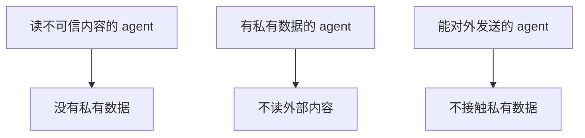

## Q
**Lethal trifecta · 拆开比检测更可靠**｜考点 · 必会

安全团队买了一个能"拦截 95% 提示注入"的检测产品，准备装在上面那个邮件 + 网页 + HTTP 的 agent 前面。这样够吗？更可靠的设计是什么？

## A
**不够。** Willison 的观点：Web 应用安全里 **95% 是不及格的分数**；至今"没人知道怎么 100% 可靠地防住"，减风险的设计模式存在，但不能消除风险。他的建议：**唯一可靠的办法是避免三项同时出现。**

**拆开（任去一项）：**

| 去掉的条件 | 怎么做 | 代价 |
|---|---|---|
| ① 私有数据 | 处理不可信内容的 agent 不接私有数据 | 能力变窄 |
| ② 不可信内容 | 只读取可信来源，或先隔离清洗 | 用不上网页、外部邮件 |
| ③ 对外通信 | 禁止对外请求、限制白名单域名、不渲染外部链接和图片 | 不能自动发送 |

**设计做法：**
- 把任务拆成**权限互相隔离的几个 agent / 步骤**：读网页的那个没有私有数据，处理私有数据的那个不读外部内容；
- 对外通信走白名单和人工确认；
- 再把检测当成**多一层防线**，而不是唯一防线。

**回到题目：** 先画出这个 agent 满足三项中的哪几项，拆掉至少一项；检测产品作为补充。

出处

Simon Willison《The lethal trifecta for AI agents》（2025-06-16）。表里的具体拆法为设计层面的归纳

