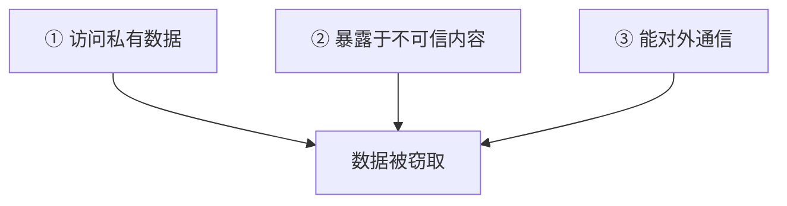

## Q
**Lethal trifecta · 三个条件**｜摘要 · 必会

一个 agent 能读你的邮件，能打开网页，还能发送 HTTP 请求。为什么说它已经处在"致命三角"里？

## A
**Simon Willison（2025 年 6 月）提出：** 一个 agent 同时具备下面**三项**，攻击者就能让它**窃取你的数据**。

| 条件 | 含义 | 例子 |
|---|---|---|
| ① 私有数据 | 能读用户的私密信息（通常正是 tool 存在的意义） | 邮件、文件、数据库 |
| ② 不可信内容 | 攻击者能控制、并让 LLM 读到的任何文字或图片 | 网页、收到的邮件、issue 评论 |
| ③ 对外通信 | 能把数据发出去的渠道 | 发邮件、发 HTTP 请求 |

**为什么致命：** LLM 会遵循**任何位置**出现的指令，并且不能可靠地判断指令来自谁，因为一切都被合并成同一串 token。攻击者在不可信内容里藏一句指令，诱使 agent 把私有数据通过对外通信发出去。例：攻击者给助手发邮件，要求转发密码重置邮件。

**回到题目：** 读邮件（①）、打开网页（②，网页内容可被攻击者控制）、发 HTTP 请求（③）——三项齐了。

**MCP 的提醒：** Willison 指出 Model Context Protocol 鼓励用户混搭来自不同来源的 tool；许多 tool 同时带有私有数据、不可信输入或对外通信中的一项或几项，有的 tool 一个就占全三项（如 GitHub MCP 的一个已披露的攻击）。

出处

Simon Willison《The lethal trifecta for AI agents》（2025-06-16，https://simonwillison.net/2025/Jun/16/the-lethal-trifecta/）

