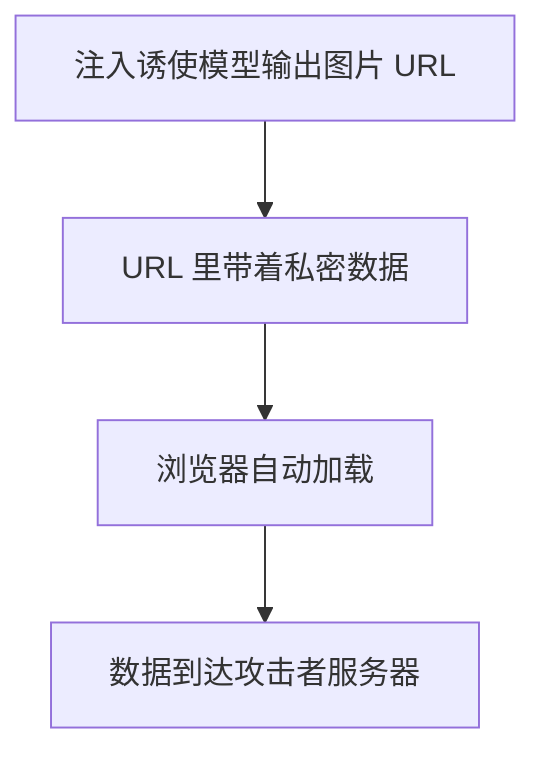

## Q
**Output handling · 渲染链接与图片的外泄通道**｜考点 · 追问

聊天界面会渲染模型回复里的 Markdown，图片会自动加载。攻击者通过间接注入让模型输出 ``。为什么这是外泄？怎么防？

## A
**机制：** 图片 URL 里**带着数据**；浏览器渲染时会**自动请求**这个 URL，对话里的私密内容就被送到了攻击者的服务器，用户无需点击任何东西。这是 lethal trifecta 里"对外通信"的一种形式：**渲染本身就是对外通信。**

| 防线 | 做法 |
|---|---|
| 域名白名单 | 只渲染来自可信域名的图片和链接 |
| 不自动加载 | 外部图片先显示为占位，用户确认再加载 |
| 内容安全策略（CSP） | 限制页面能请求的域名 |
| 输出清洗 | 剥掉或改写外部 URL 的查询参数 |
| 拆开 trifecta | 能读私密数据的会话，不渲染外部资源 |

**同类的通道：** 可点击的链接、发起 HTTP 的 tool、发邮件的 tool。

**注：** 这个具体攻击形式不在 OWASP LLM05 页面的正文里；机制是 trifecta 的"对外通信"条件在渲染场景的实例，防线按 LLM05 的"零信任、编码、CSP"思路推出。

出处

机制依据 Simon Willison《The lethal trifecta for AI agents》（对外通信）；防线依据 OWASP LLM05:2025 的 CSP 与零信任建议

