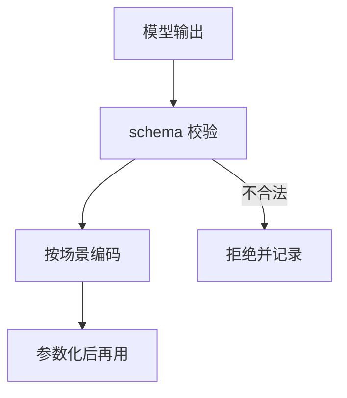

## Q
**Output handling · 把模型输出当作 untrusted input**｜摘要 · 必会

模型生成的 SQL 被后端直接执行，生成的 Markdown 被网页直接渲染。为什么这有问题？该怎么处理？

## A
**原因：** prompt 能影响模型的输出，所以**模型的输出相当于"间接的用户输入"**。把它直接交给下游，等于让攻击者间接拿到下游系统的能力。OWASP 把这叫 **Improper Output Handling（LLM05）**。

| 下游 | 风险 |
|---|---|
| 浏览器渲染 | XSS、CSRF |
| 拼接 SQL 执行 | SQL injection |
| 传给 shell、`exec`、`eval` | 远程代码执行 |
| 拼文件路径 | 路径穿越 |
| 填进邮件模板 | 钓鱼 |
| 生成代码里引用不存在的包 | 引入恶意包 |

**做法：零信任，把模型当作不可信用户：**
1. **验证**：按 schema 校验结构和字段，不合法不执行；
2. **编码**：按目标场景编码（HTML 转义、SQL 转义）；
3. **参数化查询 / prepared statements**：永远不拼接；
4. **Content Security Policy** 降低 XSS 风险；
5. **监控和记录**输出的异常模式。

**对比：** 书里提到 Output guardrails 要抓这类失败：格式错误、事实不一致、有毒内容、含敏感信息、触发远程工具或代码执行、损害品牌的回复。

出处

OWASP LLM05:2025 Improper Output Handling（https://genai.owasp.org/llmrisk/llm052025-improper-output-handling/）；Huyen《AI Engineering》ch10 §Output guardrails

