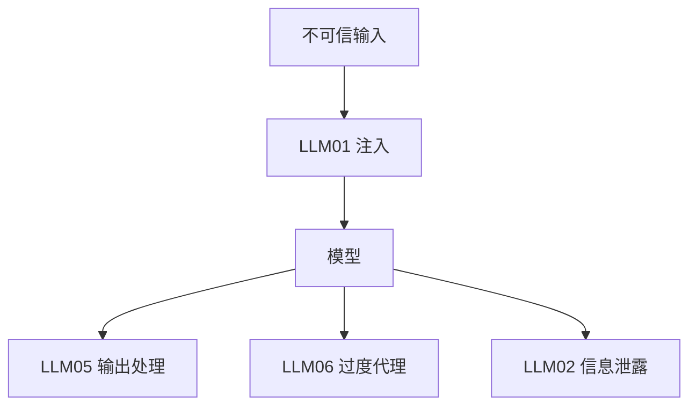

## Q
**Threat model · OWASP Top 10 for LLM Applications（2025）**｜摘要 · 必会

给一个带检索和工具的 LLM 应用做威胁建模，OWASP 的 2025 版 LLM Top 10 列了哪十项？先抓哪几项？

## A
**OWASP**（Open Worldwide Application Security Project）发布的 LLM 应用十大风险，2025 版：

| 编号 | 名称 | 一句话 |
|---|---|---|
| LLM01 | **Prompt Injection** | 输入改变了模型的行为 |
| LLM02 | **Sensitive Information Disclosure** | 泄露敏感信息 |
| LLM03 | **Supply Chain** | 模型、数据、依赖的供应链漏洞 |
| LLM04 | **Data and Model Poisoning** | 预训练、finetuning 或 embedding 数据被投毒 |
| LLM05 | **Improper Output Handling** | 对模型输出验证、清理不足 |
| LLM06 | **Excessive Agency** | 系统被授予过多的能力 |
| LLM07 | **System Prompt Leakage** | system prompt 泄露 |
| LLM08 | **Vector and Embedding Weaknesses** | 向量与 embedding 的安全风险 |
| LLM09 | **Misinformation** | 输出错误信息 |
| LLM10 | **Unbounded Consumption** | 资源（算力、费用）被无限消耗 |

**带检索和工具的应用，优先看哪几项：**
- **LLM01** 注入：入口；
- **LLM06** 过度代理、**LLM05** 输出处理：决定注入成功后**能造成多大伤害**；
- **LLM02、LLM07**：数据和 system prompt 会不会被套出去；
- **LLM10**：被滥用造成费用失控；
- **LLM08**：检索库、embedding 的权限与污染。

**怎么用：** 把十项当检查清单，对每一项问：我的应用有没有这个暴露面？现有的防护是什么？没有的补评测或监控。

出处

OWASP Top 10 for LLM Applications 2025（https://genai.owasp.org/llm-top-10/）；图和"优先级"为作者归纳

