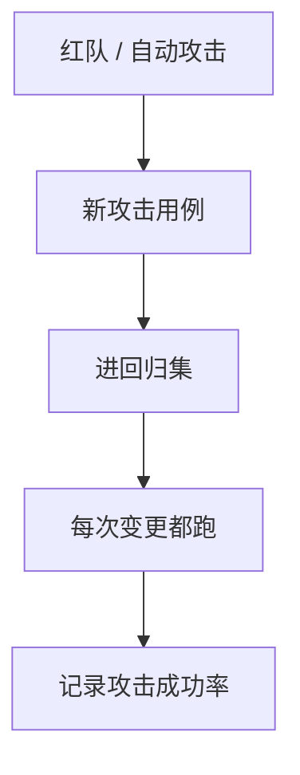

## Q
**Red teaming · 把攻击变成回归集**｜实践 · 必会

你的助手上线前要做安全测试。人工试几个「忽略以上指令」就够了吗？之后怎么持续保证？

## A
**不够。** 攻击可以自动化：

| 方法 | 原理 |
|---|---|
| 随机替换（Zou 等 2023） | 随机替换 prompt 的片段，找到能奏效的变体 |
| 让模型出点子 | 叫模型根据已有攻击构思新攻击 |
| **PAIR**（Chao 等 2023） | 一个 attacker AI：生成 prompt → 发给目标 → 根据回答改写，直到达成目标；通常不到 20 次查询就能 jailbreak |

**做法：**
1. **先搞清系统可能受哪些攻击**，再选对应的基准（Advbench、PromptRobust）和探测工具（PyRIT、garak）——它们带有已知攻击模板，自动对目标测试；
2. 有条件设**红队**，不断想新攻击；
3. 把攻击用例存成**回归集**，每次改 prompt、模型、工具都跑，进 CI；
4. 记录两个指标：**violation rate**（攻击成功比例）和 **false refusal rate**（本可安全回答却拒绝的比例），两个都要看；
5. 红队发现的攻击要转成防御：model-level（instruction hierarchy）、prompt-level（明确禁止、重复系统指令）、system-level（隔离执行、高风险操作人工批准、输入输出 guardrails）。

**别指望清零：** 只要系统有能造成影响的能力，prompt 攻击的风险就不会被彻底消除。

出处

Huyen《AI Engineering》ch5 §Jailbreaking and Prompt Injection（Automated attacks）；§Defenses Against Prompt Attacks

