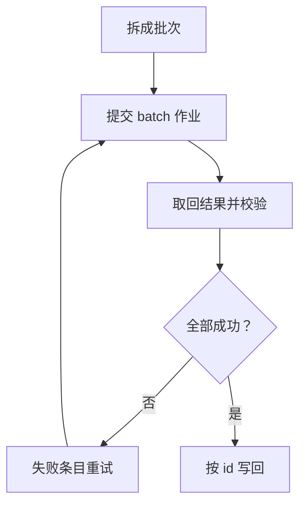

## Q
**Async processing · 设计一个批处理作业**｜实践 · 追问

要对 200 万篇文档做 LLM 提取，用 batch API。除了提交作业，工程上还要考虑什么？

## A
**要点：**
1. **分片提交：** 把 200 万条分成合适大小的批次，单个批次失败只重跑这一片；
2. **幂等与去重：** 每条记录有唯一的 id，重跑不产生重复结果；结果按 id 写回；
3. **部分失败：** 记录哪些成功、哪些失败，只重试失败的；对"模型返回了格式不对的结果"也当作失败（先校验）；
4. **结果核对：** 先在一小批上跑，用评测样本检查质量，再放量；
5. **成本和时间预估：** 周转时间是小时级，要给下游留出时间；按输入输出 token 估成本；
6. **用在线 API 做兜底：** 到期没出结果的少数请求，再走在线 API 补；
7. **记录版本：** 模型版本、prompt 版本、参数，保证以后能复现和比较。

**什么时候不适合：** 用户在等待的流程；需要根据结果立刻做下一步的 agent 循环。

出处

Huyen《AI Engineering》ch9 §Online and batch inference APIs（适用场景）。分片、幂等、重试等为通用的批处理工程做法

