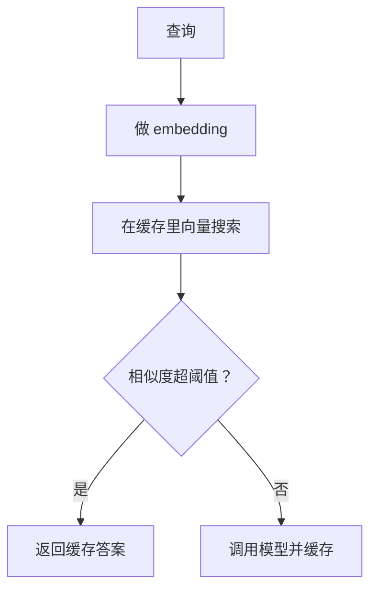

## Q
**Exact cache 与 semantic cache**｜摘要 · 必会

两个用户问"越南的首都是什么"和"越南的首都城市是什么"。应用层的缓存怎么处理？exact 与 semantic 两种有什么区别？

## A
| | Exact cache | Semantic cache |
|---|---|---|
| 命中条件 | 请求**完全相同** | **意思相近**即可 |
| 做法 | 按请求（或其键）查缓存，没有就算并存下 | 给查询做 embedding，在缓存里做向量搜索，相似度超过阈值就返回缓存结果 |
| 优点 | 简单、可靠 | 命中率更高 |
| 风险 | 命中率低 | 误命中，返回错误答案 |
| 实现 | 内存、Redis、PostgreSQL 等；要有淘汰策略（LRU、LFU、FIFO） | 额外需要向量库；要选阈值 |

**哪些不该缓存：**
- 用户相关的查询（"我最近的订单状态"）；
- 时间敏感的（"今天天气"）；
- 很多团队训练一个分类器判断"这个查询值不值得缓存"。

**书里对 semantic cache 的评价：** 价值**更可疑**，因为很多环节容易出错：依赖高质量的 embedding、可用的向量搜索、可靠的相似度度量，阈值也难定；向量搜索本身也耗时耗算力。只有命中率很高时才值得，上之前先评估效率、成本和质量风险。

**出处：** Huyen《AI Engineering》ch10 §Step 4. Reduce Latency with Caches（Exact caching、Semantic caching）
