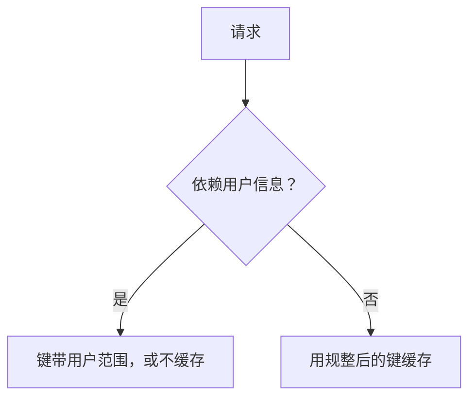

## Q
**Cache · 误命中与数据泄露，以及更安全的键**｜考点 · 必会

电商客服机器人缓存了"电子产品的退货政策是什么"的回答。后来发现用户 Y 看到了用户 X 的会员信息。怎么发生的？semantic cache 又会出什么错？怎么设计更安全？

## A
**泄露怎么发生：** 退货政策取决于会员等级。系统先检索用户 X 的信息，生成了**包含 X 信息的回答**。系统把这条查询误当成通用问题，缓存了答案。用户 Y 问同样的问题，命中缓存，看到 X 的信息。

**semantic cache 的误命中：**
- "取消订单"与"取消订阅"的 embedding 可能很近，阈值设低了就会把别的答案返回；
- 把相似度阈值调高减少误命中，则命中率下降；要在评测集上测命中率和错误率。

**更安全的设计：**

| 做法 | 说明 |
|---|---|
| **缓存键包含用户或租户范围** | 回答依赖用户信息时，键里带上用户 ID 或会员等级，不跨用户共享 |
| **只缓存与用户无关的结果** | 先判断一个查询是否依赖用户上下文；用分类器或规则 |
| **用约束输入或条目 ID 作键** | 例：把请求规整成 `policy:returns:electronics:tier=gold`，或直接按文档 ID、商品 ID 缓存，不用自由文本 |
| **缓存检索结果而非最终回答** | 向量搜索的结果可以缓存，回答每次按用户生成 |
| **设过期与淘汰策略** | 数据变了要失效 |

出处

Huyen《AI Engineering》ch10 §Exact caching 的 Warning（X / Y 泄露例子）、§Semantic caching。"用约束输入或条目 ID 作键"是常见的稳妥做法，书里无此内容

