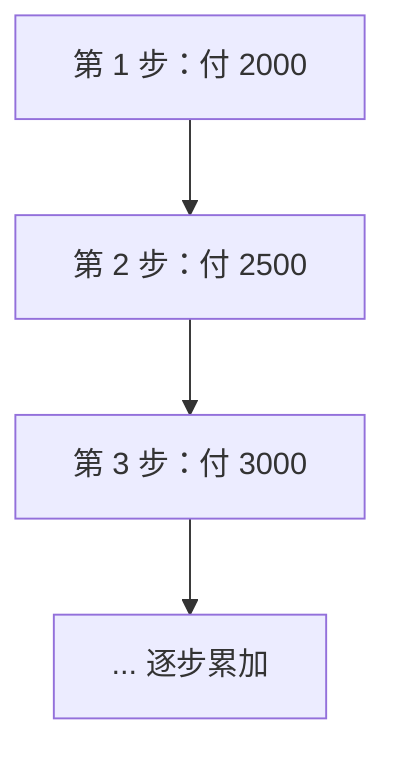

## Q
**Cost model · 每次请求怎么算钱**｜摘要 · 必会

用 model API 时，一次请求的费用由什么组成？为什么 agent 比单次调用贵得多？

## A
**公式（不写具体单价，会过时，以官方价格表为准）：**

```
一次请求成本 = 输入 token 数 × 输入单价
            + 输出 token 数 × 输出单价
            (+ 缓存读写部分，按供应商单独计价)
```

- API 一般**按 token 计费**，输入和输出分别计价；输出通常比输入单价更高；
- 所以降成本的方向：减少输入 token、减少输出 token、让重复的输入走缓存（缓存命中的输入按更低的价格计，通常还要为缓存存储或写入另付费，见 prompt caching 的卡）；
- 自托管时，成本是算力；API 的每 token 价格随规模变化不大，自托管则规模越大每 token 越便宜。

**agent 的上下文每步重复付费：** 每一步都把前面所有内容再发一遍。

| 假设 | 数 |
|---|---|
| system prompt | 2,000 token |
| 每步新增的 tool 输出 | 500 token |
| 步数 | 10 |

第 i 步的输入 = 2,000 + 500 × (i − 1)。10 步输入总和 = 20,000 + 500 × (0+1+…+9) = **42,500 token**，而内容本身最后只有约 7,000 token。**步数越多，重复付费越多，成本约随步数的平方增长。**



**怎么降：** 前缀缓存（system prompt 和历史不变的部分）、压缩历史、把大块 tool 输出只放摘要、用更小的模型处理简单步骤。

<details class="pt" markdown="1"><summary>出处</summary>

Huyen《AI Engineering》ch4 §Cost and Latency（按 token 计费）、ch9 §Prompt caching。agent 的累计账是按上面假设做的算术

</details>
