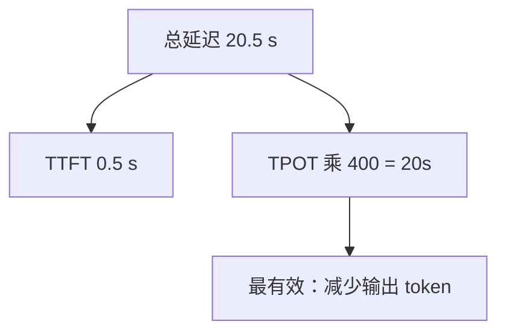

## Q
**Latency 分解 · TTFT、TPOT、总延迟**｜摘要 · 必会

一个回答要 400 个 token，TTFT 0.5 秒，TPOT 50 毫秒。用户要等多久？想把它压到 6 秒以内，先动哪里？

## A
**定义：**

| 指标 | 含义 | 受什么影响 |
|---|---|---|
| **TTFT**（time to first token） | 发出请求到第一个 token 出来 | prefill（处理输入）的时间，**输入越长越慢** |
| **TPOT**（time per output token） | 第一个之后，每个输出 token 的时间 | decode（逐个生成）的速度 |
| **总延迟** | 收到完整回答 | **TTFT + TPOT × 输出 token 数** |

**算：** 0.5 + 0.05 × 400 = **20.5 秒**。

**最大的头在输出：** 把输出压到 100 token：0.5 + 0.05 × 100 = **5.5 秒**。所以书里说可以通过**让模型简洁**、设置停止条件来控制延迟。

**其他办法：**
- **流式输出：** 每个 token 生成就返回，用户更早看到第一个字，感知延迟小得多；缺点是回答显示前无法先评分；
- **并行调用：** 互相独立的步骤同时发；
- **缩短输入：** 降低 TTFT；
- 流式时，TPOT 只需快过人读的速度：快读者约 120 ms/token（6–8 token/秒）。

**看用户感知的延迟：** agent 或 CoT 场景里模型会先生成用户看不到的中间步骤，用户感知的 TTFT 要长得多，所以有人用 time to publish（用户看到的第一个 token）。

**出处：** Huyen《AI Engineering》ch9 §Latency, TTFT, and TPOT；ch4 §Cost and Latency
