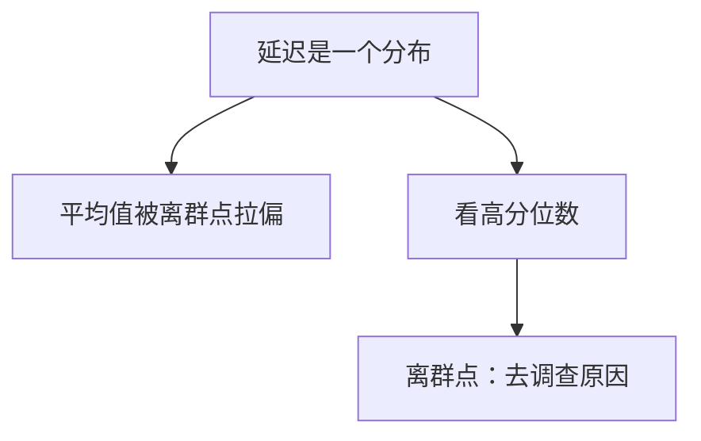

## Q
**Latency · 为什么看分位数，不看平均**｜考点 · 必会

10 个请求的 TTFT（毫秒）：100、102、100、100、99、104、110、90、3000、95。平均值是多少？应该报告什么？

## A
**平均值：** (100+102+100+100+99+104+110+90+3000+95) ÷ 10 = 3,900 ÷ 10 = **390 ms**。

但 9 个请求都在 90–110 ms，**一个 3000 ms 的离群值**把平均数拉到了 390，让服务显得比实际慢得多。

**看分位数（percentile）：**
- **p50（中位数）：** 这批约 100 ms：一半请求比它快；
- **p90、p95、p99：** 看尾部；上面那个 3000 ms 会体现在 p90 之上；
- 离群值是**线索**：可能是网络错误，也可能是一个特别长的 prompt。要去查，而不是平均掉；
- 把 TTFT 与**输入长度**画成图，容易看出是不是长输入造成的。

**还要分层看：** 每个用户、每个功能、每个版本分别看，才知道规模变大时系统怎么表现。

**出处：** Huyen《AI Engineering》ch9 §Latency, TTFT, and TPOT（10 个请求的例子，平均 390 ms、percentile）；ch10 §Metrics（按用户跟踪）
