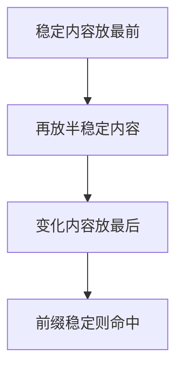

## Q
**Prompt caching · 把不变的放前面**｜考点 · 必会

团队开了 prompt caching，命中率却接近 0。prompt 的结构是：用户姓名与当前时间 → 长的产品手册（5 万 token）→ 行为规则 → 用户问题。问题出在哪？怎么改？

## A
**原因：** 缓存按**前缀**匹配：从 prompt 开头起，**一段一段完全相同**才能命中。第一行就有每次都变的"姓名和当前时间"，**后面的全部内容都对不上**，长手册也就缓存不了。

| | 顺序（从前到后） | 结果 |
|---|---|---|
| 改前 | 姓名与时间 → 产品手册 → 行为规则 → 用户问题 | 第一段每次都变，后面整段都无法复用 |
| 改后 | 产品手册 → 行为规则 → 姓名与时间 → 用户问题 | 前两段是稳定前缀，可缓存；后两段是变化部分 |

**设计规则：**
- **稳定的在前、变化的在后：** system prompt、工具定义、长文档在前；用户输入、时间戳、会话 ID 在后；
- 不要在前缀里放**会变的东西**（时间戳、随机 id、动态排序的列表）；
- 多轮对话**只在末尾追加**，不要改动前面的消息；
- 命中条件、保留时间、最小长度是供应商相关的，用响应里的缓存用量字段检查命中率。

**别忘了：** 缓存的是"处理 prompt"的工作，输出仍要生成；所以它主要降低 **TTFT 和输入成本**，不减少输出的时间。

出处

Huyen《AI Engineering》ch9 §Prompt caching（重叠文字段、system prompt 作为公共前缀）；ch10 §Step 4。前缀匹配与排序规则是此类缓存的通用做法，具体条件见各供应商文档

