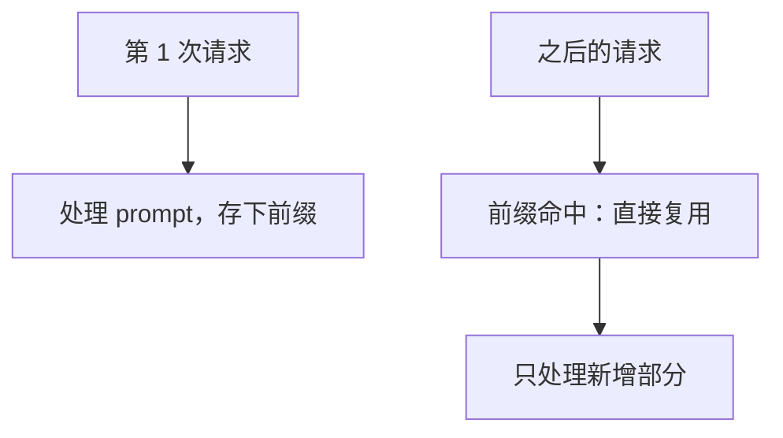

## Q
**Prompt caching · 缓存的是什么，省多少**｜摘要 · 必会

应用每次请求都带着同一个 1,000 token 的 system prompt，每天 100 万次调用。prompt caching 帮了什么忙？

## A
**机制：** 许多 prompt 有**重叠的文字段**，最常见的是 system prompt。prompt cache 把这些重叠部分的处理结果存起来复用，**只需处理一次**（也叫 context cache、prefix cache）。

**算：** 1,000 token × 100 万次 = 每天约 **10 亿**个重复的输入 token 不用再处理。

**适合：**
- 长 system prompt；
- 许多问题围绕同一份长文档（长篇文档、一个代码库）；
- 多轮长对话：前面的消息缓存后复用。

**Anthropic（2024）公布的数字（Huyen ch9 Table 9-3）：**

| 场景 | 首 token 延迟 | 成本 |
|---|---|---|
| 与长文档对话（10 万 token 的缓存 prompt） | 11.5 s → 2.4 s（−79%） | −90% |
| many-shot（1 万 token 的 prompt） | 1.6 s → 1.1 s（−31%） | −86% |
| 10 轮对话、长 system prompt | 约 10 s → 约 2.5 s（−75%） | −53% |

**代价：** 缓存会占内存；自己实现需要不少工程；用供应商 API 时，缓存存储或写入通常要另外付费。折扣比例、保留时间、最小长度这些都是**供应商相关、会变**的，以官方文档为准。

出处

Huyen《AI Engineering》ch9 §Prompt caching（Table 9-3）

