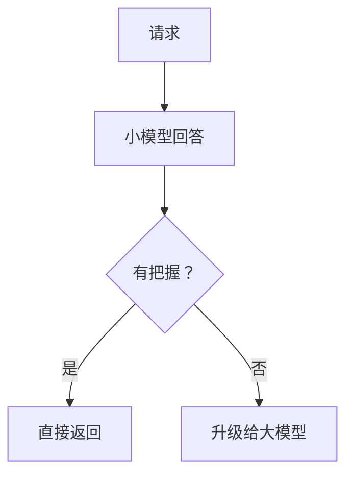

## Q
**Model routing 与 cascade**｜摘要 · 必会

客服机器人里 70% 的问题是简单的 FAQ，其余要复杂推理。怎么既不浪费最贵的模型，又保证质量？

## A
**两种思路：**

| | 做法 | 例子 |
|---|---|---|
| **Routing（分类器路由）** | 先用**意图分类器**判断请求类型，送去对应的方案 | 重置密码 → FAQ 页面；账单更正 → 人工；技术问题 → 专门的模型；**简单的给便宜模型，难的给强模型** |
| **Cascade（级联）** | **小模型先答**；对结果**不确定**时再升级给大模型 | 分类任务里，小模型三个类别的概率都在 30–40%（没把握）就升级；一个类别达 95% 就直接采用 |

**router 的要求：** 要**又快又便宜**，才能用好几个而不增加明显的延迟和成本。常用较小的模型（GPT-2、BERT、Llama 7B）或更小的自训练分类器。

**router 的额外好处：**
- 拒绝范围外的请求，不浪费一次 API 调用；
- 对含糊的请求（如只有"Freezing"一个词）反问澄清；
- 决定下一步动作（agent 里用代码解释器还是搜索）。

**注意上下文长度：** 如果路由到上下文上限较小的模型，要截断上下文，或改路由到上限更大的模型。

**出处：** Huyen《AI Engineering》ch10 §Router；ch4 §Select evaluation methods（用 logprobs 判断分类把握）；Anthropic《Building effective agents》Routing（简单问题给小模型）。cascade 的做法依据 ch4 里 logprobs 反映把握度的论述
