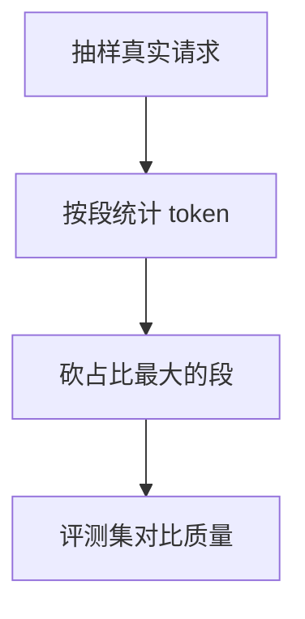

## Q
**减 token · 先量再砍**｜实践 · 必会

月账单太高，有人说「把 system prompt 改短就行」。你怎么确定该砍哪里？

## A
**先量：** 对一批真实请求，按段统计 input 和 output 的 token 数，再看每段占总成本的比例。

| 段 | 常见的浪费 | 对策 |
|---|---|---|
| system prompt | 冗长、重复的指令；示例太多 | 精简措辞；示例只留有区分度的几条；稳定的部分放前面以便 prompt caching |
| 对话历史 | 全部原样带上 | 总结旧轮次；只留最近 N 轮；清掉旧的工具返回 |
| 检索内容 | top-k 取太多，chunk 太大 | 用 reranker 减少放进 context 的文档数；调小 chunk；设相关度下限 |
| output | 啰嗦、重复提问、格式冗余 | 提示里要求简洁；限制最大输出 token；设 stop 条件；用结构化短字段代替长文 |

- output token 比 input token 贵、而且是逐个生成的，所以**缩短 output 对延迟和成本两边都最有效**；
- 注意提早停止的副作用：要求输出 JSON 时，截断会让括号缺失、无法解析；
- 上下文越长，模型对中间信息越容易忽略，缩短 prompt 常常**同时提升质量**。

**改完要验证：** 每砍一处，用评测集对比质量，别只看省了多少钱。

出处

Huyen《AI Engineering》ch5 §Context Length and Context Efficiency；ch4 §Cost and Latency；ch6 §Reranking（减少放进 context 的文档数）

