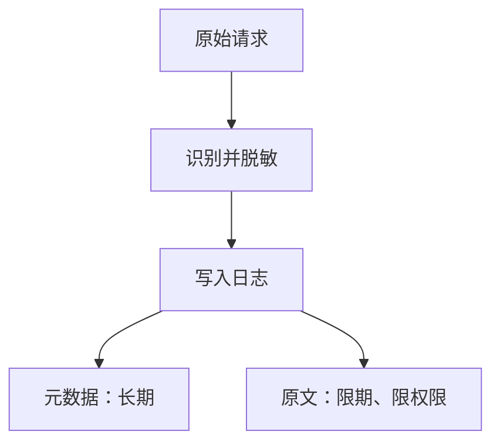

## Q
**Logging 里的 privacy 与 retention**｜摘要 · 必会

排障要求"什么都记"，包括用户的原始问题和完整 prompt。可用户的问题里有手机号、病历。这两者怎么调和？

## A
**矛盾：** 为了排障要多记，为了隐私要少记。解法是**记得全，但分级、脱敏、限期**。

| 手段 | 做法 |
|---|---|
| **脱敏（redaction）** | 在写入日志**之前**识别并遮盖个人信息（手机号、证件号、银行账号等）。书里在输入端的做法是把敏感数据换成占位符，如 `[PHONE NUMBER]`，需要时再用反向映射还原 |
| **分级存储** | 元数据（耗时、token 数、模型版本）长期保留；原文（用户输入、完整 prompt）单独存放、严格权限 |
| **采样** | 不必每条都存原文，按比例采样，加上所有失败和被用户差评的请求 |
| **保留期（retention）** | 原文只保留排障和评测所需要的时间，到期删除；元数据可以更长 |
| **访问控制与审计** | 能看原文的人要少，看了要有记录 |
| **用户知情** | 用户有权知道自己的数据怎么被使用；把反馈和数据用于训练要告知 |

**风险项：** OWASP 把 **Sensitive Information Disclosure（LLM02）** 列为十大风险之一；日志、缓存、trace 工具里的原文本身就是一个泄露面。

**不要忘了：** 敏感数据检测也会漏；所以仍要有保留期和权限这两道防线。

出处

Huyen《AI Engineering》ch10 §Input guardrails（PII 遮盖与还原）、§User Feedback（用户数据的使用）；OWASP LLM02:2025。分级与保留期的具体做法为通用的工程做法，书里无专节

