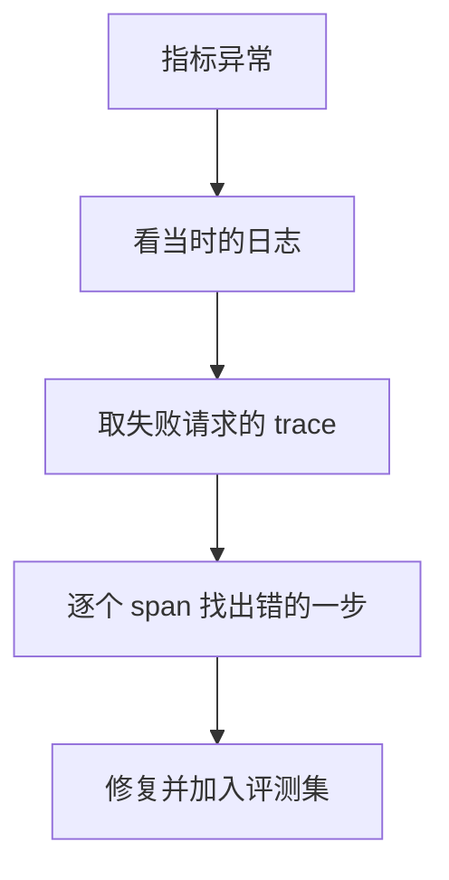

## Q
**Trace · 一次线上故障的排查流程**｜实践 · 必会

监控显示五分钟前开始，用户反馈的"答非所问"比例突然升高。你怎么一步步排查？日志延迟了 15 分钟会怎样？

## A
**书里的排查步骤：**
1. **Metrics 告诉你出事了**，但没说发生了什么；
2. 看出事时间点前后的 **logs**，弄清发生了什么；
3. 把日志里的错误**与指标对应起来**，确认找对了问题。

**在 trace 里逐步查：**

| span | 看什么 | 指向的问题 |
|---|---|---|
| 查询改写 | 改写后的问题还对吗 | 改写出错 |
| 检索 | 取回的文档与问题相关吗 | 检索问题（chunking、embedding） |
| 最终 prompt | 资料有没有放进去？顺序？长度？ | prompt 组装问题 |
| 模型调用 | 输出是否忠实于资料 | 模型或 prompt 问题 |
| tool | 返回是否正确 | tool 问题 |
| 配置 | 最近 prompt 模板或模型名称变了吗 | 漂移 |

**关键：** 快速发现要求指标**算得快**；快速响应要求日志**随时可查**。**日志延迟 15 分钟，就要等 15 分钟才能查五分钟前的事**。

**记录原则：** 你不知道将来要看哪条日志，所以通则是**什么都记**：配置、用户查询、最终 prompt、输出、中间输出、tool 的调用与输出、各组件的开始结束与崩溃；记录要带标签和 ID。量大后用 AI 工具做日志分析和异常检测。

**每天人工看一些线上数据：** Shankar 等（2024）发现，开发者对"好与坏"的看法会随着看更多数据而变化，从而既改 prompt 也更新评测。

出处

Huyen《AI Engineering》ch10 §Logs and traces

