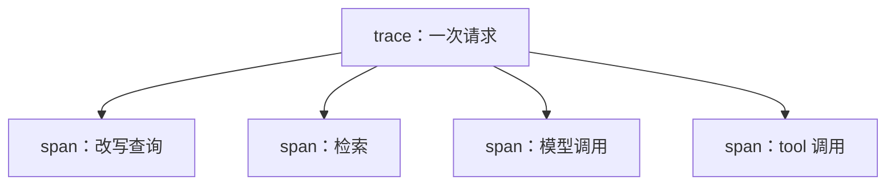

## Q
**Trace 与 span · 一次请求里的每次模型与工具调用**｜摘要 · 必会

用户反馈"这个回答不对"。你只有一个聚合的"质量分下降"曲线。要定位到某一次请求具体错在哪一步，需要记录什么？

## A
**三个层次：**

| | 是什么 | 回答什么 |
|---|---|---|
| **Metrics** | 聚合的数值（错误率、延迟、成本） | 出事了吗？趋势如何？ |
| **Logs** | 事件的追加式记录 | 当时具体发生了什么？ |
| **Traces** | 把一次请求相关的事件**串成完整时间线** | 这次请求每一步怎么走的，哪一步出错 |

**Trace 与 span：** 一个 trace 是一次请求从进入到返回的**完整执行路径**；组成它的每一个步骤（一次检索、一次模型调用、一次 tool 调用、一次 guardrail 检查）是一个 **span**，有开始、结束时间和所属的上一级。

**每个 span 该记什么：**
- 输入和输出（含**最终发给模型的 prompt**、检索到的文档、tool 的返回）；
- 耗时（延迟）、token 数、成本（可测的话）；
- 配置：模型名称、API endpoint、采样参数（temperature、top-p、top-k、stopping condition）、prompt 模板；
- 标签和 ID：能看出这条记录来自系统的哪一部分。

**能做到的事：** 失败时能精确指出：是查询被错误处理了，检索的 context 不相关，还是模型生成了错误回答。

**生成式 AI 的标准：** OpenTelemetry 为 GenAI 客户端定义了 spans、metrics、events 的语义约定（已迁到 semantic-conventions-genai 仓库），统一不同工具记录模型调用的方式。

**出处：** Huyen《AI Engineering》ch10 §Logs and traces；OpenTelemetry semantic-conventions-genai 仓库说明（https://github.com/open-telemetry/semantic-conventions-genai）
