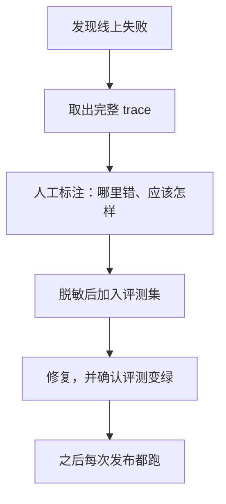

## Q
**从 production traces 到 eval set · 把失败变成测试**｜实践 · 必会

用户投诉了一个线上失败。怎么让它变成一条以后每次发布都会检查的测试，而不是修完就忘？

## A
**闭环：**

| 步骤 | 要点 |
|---|---|
| 发现 | 差评、重新生成、转人工、监控报警、用户纠错 |
| 取 trace | 取出含检索、tool、最终 prompt 的完整记录 |
| 标注 | 写下期望的行为和失败原因（归入 failure mode）；**标注界面要把所有上下文放在一屏**，降低看数据的摩擦 |
| 入集 | 脱敏；放进"已知常出错"的那一份评测集 |
| 验证 | 修之前它应该是红的，修之后变绿；并确认没有让其他样本变差 |
| 持续 | 每次改 prompt、模型、检索都跑回归 |

**来源要用真实数据：** 评测数据最好来自真实的生产数据；用户反馈（尤其是用户对回答的**编辑**）也可以作为偏好数据。

**为什么这是排障闭环的核心：** 同一个失败第二次出现，说明评测集里没有它。

**出处：** Huyen《AI Engineering》ch4 §Annotate evaluation data（用生产数据）、ch10 §User Feedback（用户编辑作为偏好数据）；Hamel Husain《Your AI Product Needs Evals》（看数据的界面）
