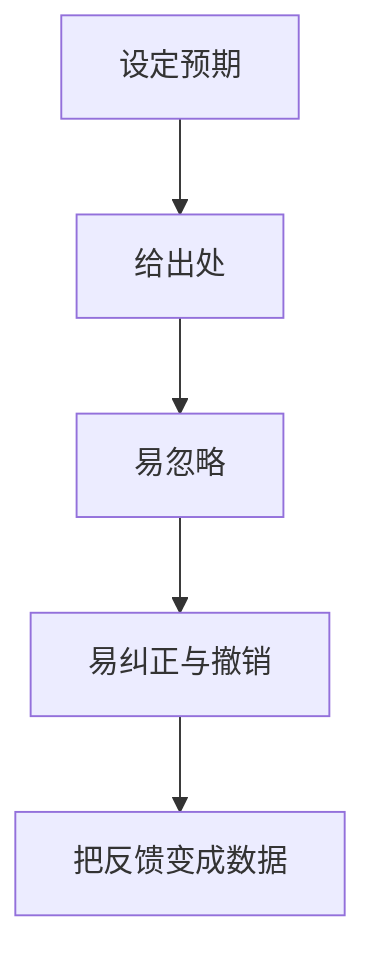

## Q
**Defensive UX**｜摘要 · 必会

LLM 一定会出错。产品界面上怎么设计，才能让用户即使遇到错误也不会受伤、不会失去信任？

## A
**核心思想：** 既然不准确和幻觉**一定会发生**，就在设计里预料到它：引导用户行为、防止误用、体面地处理错误。

| 原则 | 做法 | 例子 |
|---|---|---|
| **设定预期** | 说明能做什么、做得多好；给 AI 生成的内容加免责声明、说明限制 | 短期可能降低信任，长期建立信任 |
| **容易忽略 / 关闭** | AI 功能要能轻松忽略 | 聊天机器人不要挡住页面；Copilot 继续输入就是忽略建议 |
| **给出处（attribution）** | 解释为什么这样回答 | Bing Chat 的引用；在 LLM 的说明旁边放评价 |
| **容易纠正与撤销** | 用户能改、能撤回 | 编辑生成内容；全局控制 |
| **展示多个选项和把握度** | 不确定时给几个候选 | Apple 指南的输出模式：多选项、把握度、归因、局限 |
| **用熟悉的界面** | 用常见的交互模式 | 作者质疑聊天是否适合大多数产品 |

**参考的指南：** Microsoft《Guidelines for Human-AI Interaction》（18 条，按"开始时、交互中、出错时、长期"组织）；Google《People + AI Guidebook》（23 个模式）；Apple 的机器学习 Human Interface Guidelines（ML 是关键还是辅助、主动还是被动）。

**还有一点：** 同一个输入 LLM 可能给出不同答案，这挑战了界面的"一致性"原则。

**出处：** Eugene Yan《Patterns for Building LLM-based Systems & Products》（Defensive UX；https://eugeneyan.com/writing/llm-patterns/）；Huyen《AI Engineering》ch1 §The role of AI and humans（主动功能质量门槛更高）
