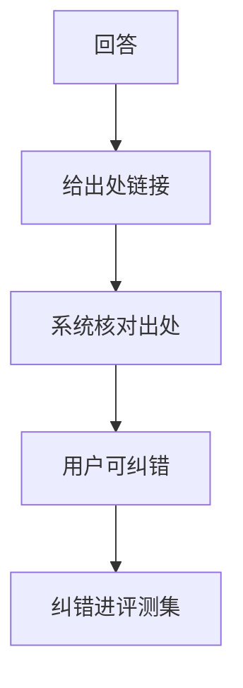

## Q
**Defensive UX · 改造一个会出错的界面**｜考点 · 必会

一个法律检索助手：用户问问题，它直接给出一段很肯定的回答，没有出处，也没有办法改。上线后用户抱怨"它编了一个不存在的判例"。怎么改？

## A
| 问题 | 改造 | 对应原则 |
|---|---|---|
| 语气肯定、无限制说明 | 界面上说明"AI 生成，可能有错，请核对原文"，对低把握度的回答用更谨慎的表述 | 设定预期 |
| 没有出处 | 每条结论旁边给出引用的判例和**原文链接**，用户一点就能核实 | 给出处（attribution） |
| 编造的判例无法发现 | 引用经系统核对（链接是否真实存在）；找不到来源的说法标记或不显示 | 出处核对；faithfulness 检查 |
| 无法纠正 | 用户可以修改、标记"这条错了"、请求重新生成；错误反馈进评测集 | 容易纠正；反馈入数据 |
| 全部必须一次读完 | 回答可折叠，结论与依据分层；高风险结论加人工复核入口 | 容易忽略 / 升级给人 |
| 出错就沉默 | 检索不到时明确说"没有找到"，而不是编一个 | 体面地处理错误 |

**结果：** 用户错误的代价从"相信编造的判例"变成"点开链接发现没有"，信任来自**可验证**，而不是**永不出错**。

**出处：** Eugene Yan《Patterns for Building LLM-based Systems & Products》（Defensive UX：set expectations、efficient dismissal、attribution）；Huyen《AI Engineering》ch4 §Factual consistency（核对）
