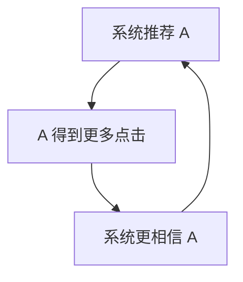

## Q
**Feedback 的 bias 与 degenerate feedback loop**｜考点 · 必会

某应用的评分平均 4.8 分，团队认为用户非常满意。另一个推荐系统只根据点击来更新，几个月后内容越来越单一。各是什么问题？

## A
**Leniency bias（宽容偏差）：** 用户倾向于给出比实际更好的评分，为了省事或不想得罪人。

- 例：Uber 在 2015 年司机平均评分 4.8，低于 4.6 有被停用的风险。这不一定是问题，只要系统仍能区分好坏司机。
- **看分布，不只看平均**；
- 想要更细的反馈，去掉低分的强烈负面含义：不显示 1–5 分，而是"很棒""还不错""没什么可抱怨但也不出色""本可以更好""不要再匹配这个司机"。

**Randomness（随机）：** 用户没动力认真给反馈，如并排比较两个长回答时，随手点一个。

**Position bias（位置偏差）：** 排在前面的选项更容易被点击；点击不一定说明它好。缓解：随机化位置，或建模算出按位置修正后的成功率。

**Preference bias：** 偏爱更长的回答（长度比不准确更容易注意）、recency bias（偏爱最后看到的）。

**Degenerate feedback loop：** 反馈只来自你展示给用户的内容；**预测本身影响反馈，反馈又影响下一轮模型，放大初始偏差**。

- 推荐系统：排名靠前的视频点击多，越排越前；
- 例：少数用户说喜欢猫的照片，系统多生成猫，吸引爱猫的人，直至变成"猫的天堂"；
- 用反馈训练还会让模型**迎合**用户（sycophancy）：给用户想要的，而不是最准确的。

**回到题目：** 第一个看评分分布；第二个是 degenerate feedback loop，要引入探索（随机展示一部分），并检查反馈覆盖面。

出处

Huyen《AI Engineering》ch10 §Feedback Limitations（Biases、Degenerate feedback loop）

