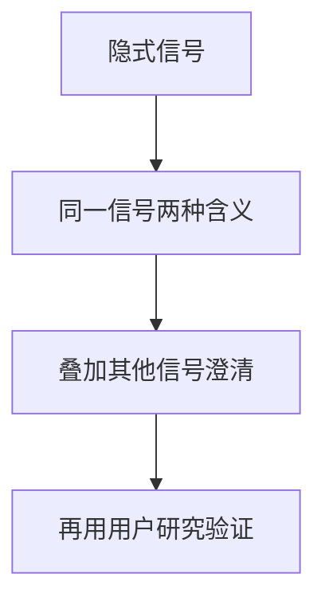

## Q
**Implicit feedback · 这些信号是好是坏**｜考点 · 必会

下面几条数据，分别更可能说明什么？还需要什么才能确定？

1. 一个客服机器人的平均对话轮数从 4 涨到 9；
2. 图片生成应用里"重新生成"的点击率很高；
3. 一个用户的对话被"分享"了很多次；
4. 用户把代码助手生成的代码改了一半后才采用。

## A
| 现象 | 可能的解读 | 要补充的信息 |
|---|---|---|
| 1 轮数涨 | 对**客服**类产品，更可能是**更低效**：用户没一次问清楚，或机器人没解决问题 | 同时看解决率、转人工率；对话多样性（是否在重复） |
| 2 重新生成多 | 对创意任务可能只是想看更多选择；对要准确答案的任务才是不满意 | 按任务类型分开看；计费方式（按用量计费时，用户更少随手重新生成） |
| 3 分享多 | 可能是分享有用的内容，也可能是分享出错的例子 | 分享之后的动作（是否马上重新表述）；用户调查 |
| 4 改了才采用 | 强信号：被改的那部分不完全对；采用说明总体还可用 | 编辑距离、被改的位置；可作为（原输出，修改后）的偏好对 |

**原则：** 隐式信号**更多但更噪**，要先研究用户为什么这样做，再把它当作指标；多个信号合在一起才可靠。

出处

Huyen《AI Engineering》ch10 §Extracting Conversational Feedback（Conversation length、Regeneration、Conversation organization、user edits）

