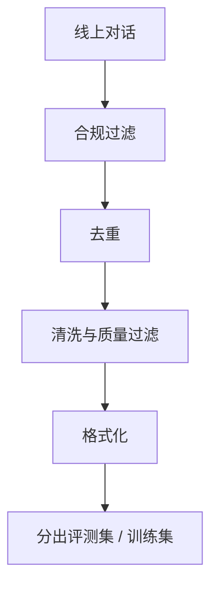

## Q
**Production data · 变成 eval set 和 training data**｜实践 · 必会

线上积累了几十万条对话，团队想拿来做评测集，再拿来微调。直接导出可以吗？要经过哪些处理？

## A
**不可以直接导出。** 数据处理流水线：

| 步骤 | 做什么 | 原因 |
|---|---|---|
| inspect | 人工看一批；统计长度分布、主题分布 | 先弄清数据长什么样，人看数据常能发现启发式规则 |
| 合规 | 去掉 PII、敏感与受版权保护的数据，去标识；**确认有没有权利使用用户数据** | 用户同意、隐私条款、各国法规 |
| deduplicate | 整篇、段内、跨文档重复；可用两两比较、哈希（MinHash）、降维后比较 | 重复会扭曲分布；更严重的是**评测集和训练集里有同一条**会造成污染 |
| clean / filter | 去掉多余的 HTML / Markdown 标记；去低质量数据；必要时用 active learning 选最有用的样本 | Databricks 去掉多余标记后，准确率提高 20%，输入 token 长度减少 60% |
| format | 套上目标模型的 chat template | 模板错了会有奇怪的 bug |

**关键纪律：**
- **先划分再处理：** 评测集在最开始就隔离，之后永不进入训练，否则评测没意义；
- 好数据的六个特征：relevant、对齐任务要求、consistent、格式正确、sufficiently unique、compliant；
- 反馈信号（点赞、编辑）可以变成偏好数据，但有偏差（见 feedback 那组卡）；
- 谁有权使用用户数据，要先问法务和隐私政策，不是工程师自己决定。

**出处：** Huyen《AI Engineering》ch8 §Data Processing（Inspect、Deduplicate、Clean and Filter、Format）；§Data Quality；ch10 §User Feedback
