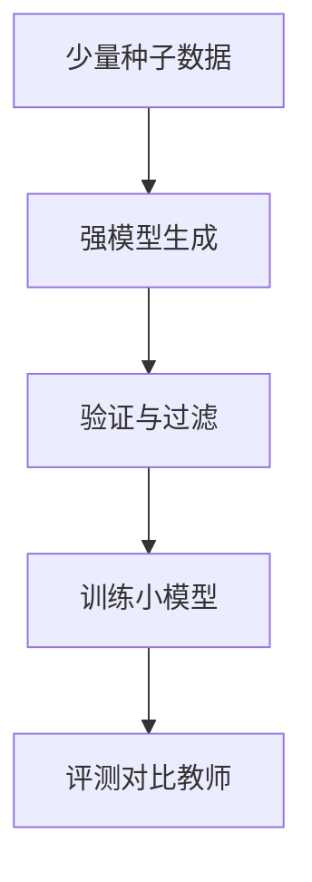

## Q
**Synthetic data 与 distillation · 工程流程和风险**｜实践 · 必会

团队想用强模型生成十万条训练数据，微调一个便宜的小模型替代它。流程怎么走？有哪些坑？

## A
**流程：**

**model distillation**：用大模型（teacher）的输出训练小模型（student）去模仿它，目标是更小更快的模型，性能接近。例子：Alpaca 用 text-davinci-003 生成的数据微调 Llama-7B，大小只有教师的 4%；BuzzFeed 用 LoRA 加教师生成的数据微调 Flan-T5，推理成本降低 80%（性能怎样不清楚）。

**验证是关键（data verification）：**
- 能程序验证的优先：代码类数据靠执行结果；Llama 3 的合成数据主要是代码，因为可验证；
- 不能验证的用 AI verifier（打分、分类好坏）；
- 启发式过滤：空的、太短或太长的、重复的、指令相同但回答不同的、输出只是重复输入的（Self-Instruct 的做法）；
- 最终检验：训练后在真实评测集上是否提升。

**四个坑：**

| 坑 | 说明 |
|---|---|
| 质量不可控 | garbage in, garbage out |
| superficial imitation | 学到教师的风格，事实性和泛化不一定跟上；还可能被迫学会「看起来像解答」的幻觉 |
| model collapse | 递归地用 AI 生成的数据训练，会逐渐丢掉罕见情形；与真实数据混合可以避免，但没有定论的比例 |
| 数据来源不清 | 教师模型若侵权或见过你的 benchmark，你也被污染 |

**许可：** 很多模型的许可禁止用其输出训练别的模型（尤其是竞争模型），开始前先查教师模型的条款。

**出处：** Huyen《AI Engineering》ch8 §Data Augmentation and Synthesis（Why Data Synthesis、Data verification、Limitations）、§Model Distillation；ch4 §Open source, open weight, and model licenses
