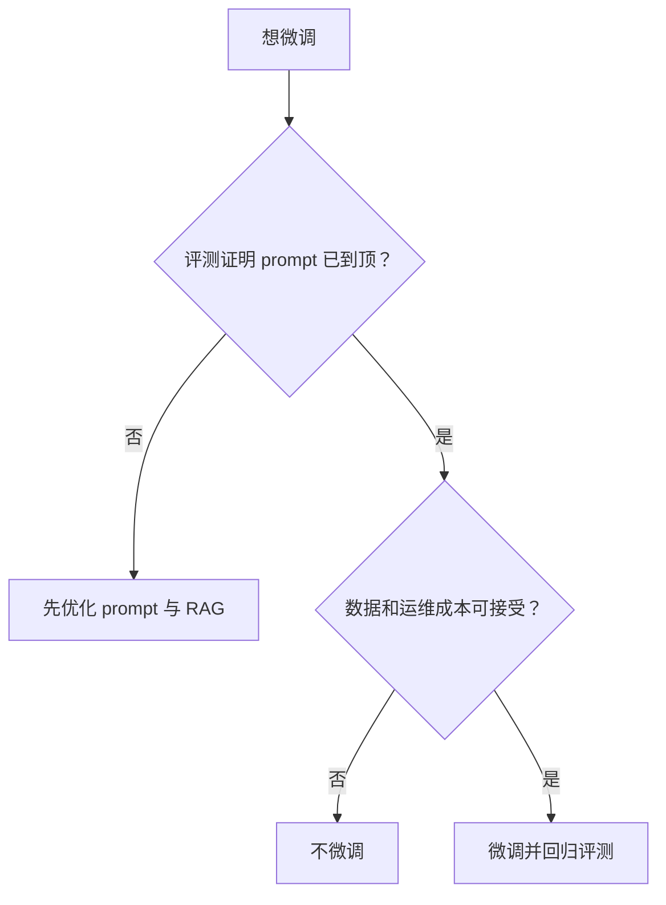

## Q
**Finetuning · 决策练习**｜考点 · 必会

三个团队都想微调：A）客服机器人常常答错最新的退货政策；B）一个小模型生成的 JSON 经常缺字段，需要稳定输出一个冷门的内部配置语法；C）用大模型处理每天上百万请求，成本太高，请求形态很固定。各应该怎么办？

## A
| 团队 | 失败类型 | 建议 |
|---|---|---|
| A | **信息类**（过时） | **RAG**，不要微调；把政策放进检索库并做好版本管理 |
| B | **行为类**（格式；冷门语法） | 先试 prompt、结构化输出（含 constrained sampling）；仍不行再 **finetuning**，书里说冷门语法正是微调的合适场景 |
| C | 成本与延迟 | **finetuning 一个小模型**，用大模型生成的数据（distillation）；先确认请求形态稳定、评测集齐全 |

**微调之前的检查清单：**
1. 评测：有没有评测集和评测流程？能证明 prompt 方案已经到顶？
2. 数据：有没有足够的、质量好的数据？谁来标注？
3. 其他任务：会不会让别的任务变差？
4. 运维：怎么托管？谁维护？新模型出来怎么办？
5. 收益：节省的成本或提高的质量，是否大于上述成本？

出处

Huyen《AI Engineering》ch7 §Reasons to Finetune、§Reasons Not to Finetune、§Finetuning and RAG

