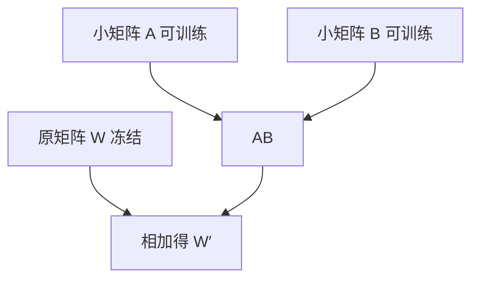

## Q
**LoRA 与 PEFT · 只训小矩阵**｜摘要 · 必会

微调一个大模型要更新几十亿个参数，显存吃不消。PEFT（parameter-efficient finetuning）是什么思路？LoRA 具体怎么做？

## A
**PEFT：** 只训练**很少的一部分参数**，其余保持不动，用更少的内存和数据达到接近全量微调的效果。

**LoRA（Low-Rank Adaptation）：** 对一个权重矩阵 W（n × m）：
1. 选一个小的数 r（rank）；造两个小矩阵 A（n × r）和 B（r × m）；它们的乘积 AB 与 W 同样大；
2. 新矩阵 W′ = W + (α/r) · AB；
3. 微调时**只更新 A 和 B**，W 保持不变。

**为什么省参数（低秩分解）：** 书里的例子：一个 9 × 9 的矩阵有 81 个参数，分解成 9 × 1 和 1 × 9 两个矩阵只有 18 个。分解是有损的近似，rank 越高保留的信息越多。

**数字：** LoRA 论文里 GPT-3 只训练约 470 万个参数，是全量微调的 0.0027%，在多个任务上效果相当或更好。

**优点：** 比原始的 adapter 方法不增加推理延迟（可以合并回原矩阵）；参数效率和样本效率都高。

**代价：** 效果通常不如全量微调；实现上要改模型代码（热门基础模型的 PEFT 框架如 Hugging Face PEFT、Axolotl、unsloth 一般已支持）。

出处

Huyen《AI Engineering》ch7 §Parameter-Efficient Finetuning → LoRA

