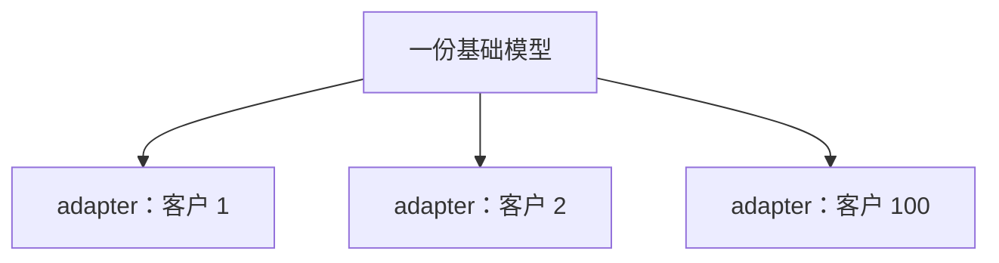

## Q
**LoRA · 热插拔多个 adapter、显存账怎么算**｜考点 · 必会

你为 100 个客户各微调一个 LoRA。每个客户一个完整模型 vs 共用一个基础模型加 100 个 adapter，存储差多少？还有，13B 参数的模型做推理要多少显存？

## A
**多 adapter 的存储账（书里的数字）：** 设某个权重矩阵 W 为 4096 × 4096（约 1,680 万参数），LoRA rank = 8，则 A 和 B 共 4096 × 8 × 2 = 65,536 个参数。

| 方案 | 100 个客户的总参数 |
|---|---|
| 每个客户合并成独立的 W′ | 16.8M × 100 = **1.68B** |
| 一份 W + 100 组 (A, B) | 16.8M + 65,536 × 100 ≈ **23.3M** |

**另外：** 切换客户只需加载新的 adapter，比加载整个权重快得多；保持 adapter 分开会增加一点推理延迟（可优化）。只服务一个 LoRA 模型时，合并后服务更好；服务多个共享同一基础模型的 LoRA 时，保持分开更好。Apple 就用多个 LoRA adapter 让同一个 3B 参数的基础模型适配不同的 iPhone 功能。

**推理显存的账（书里的估算）：** 显存 ≈ 参数数 N × 每个参数的字节数 M × 1.2（多出的 20% 给 activation 和注意力的 key / value 向量）。

- 13B 参数、每个 2 字节：13B × 2 = **26 GB**；× 1.2 = **31.2 GB**；
- 70B 参数、每个 2 字节：仅权重就要 140 GB。

**训练要更多：** 训练内存 = 权重 + activation + gradient + optimizer state。gradient 和 optimizer state 与**可训练参数的个数**成正比，所以 LoRA 只训小矩阵，能大幅降低训练显存。

**出处：** Huyen《AI Engineering》ch7 §Serving LoRA adapters、§Memory Math
