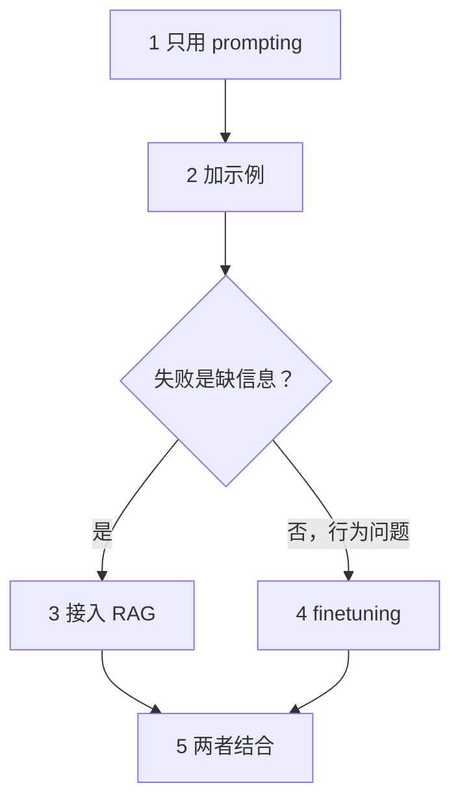

## Q
**先 prompting、再 RAG、最后 finetuning**｜摘要 · 必会

同事说"模型不够好，我们微调吧"。你会按什么顺序、用什么依据来选择 prompting、RAG、finetuning？

## A
**顺序（书里的流程，评测贯穿每一步）：**

| 步骤 | 做什么 |
|---|---|
| 0 | **先定评测标准和评测流程** |
| 1 | 只靠 prompt，系统地做实验，并给 prompt 做版本管理 |
| 2 | 加示例（视用例，1 到 50 个） |
| 3 | 因为**缺信息**而失败，就接入数据源；先用简单的关键词检索（如 BM25） |
| 4 | 仍有信息类失败：更高级的 RAG（如 embedding 检索）；仍有**行为类**问题（不相关、格式错、不安全）：finetuning |
| 5 | 结合两者 |

**判断依据：失败是信息类还是行为类。**

| 失败类型 | 例子 | 办法 |
|---|---|---|
| **信息类** | 事实错误、过时，没有你组织的私有信息 | **RAG** |
| **行为类** | 事实对但与任务无关；格式错；缺少需要的细节；风格 | **finetuning** |

**一句话：finetuning 管"形式"，RAG 管"事实"。** 两种问题都有时，**先做 RAG**，因为不用整理训练数据，也不用托管微调模型。

**常见陷阱：** 有人坚持要微调，调查后发现是 prompt 实验很少且没系统性：指令不清、例子不代表真实数据、指标不明确。把 prompt 实验做好之后，就够用了。

出处

Huyen《AI Engineering》ch7 §When to Finetune、§Finetuning and RAG

