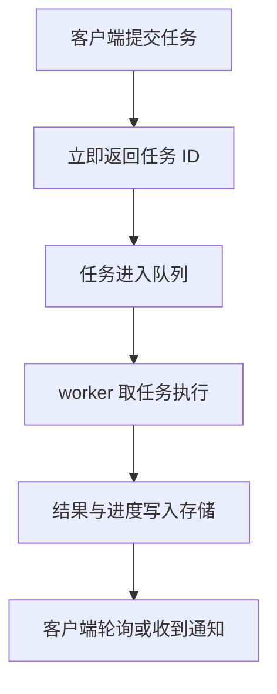

## Q
**长耗时调用 · 为什么不放在请求线程里**｜实践 · 必会

一个"生成研究报告"的功能，一次要调用模型和工具几十次，耗时 3–5 分钟。接口同步等待返回，结果高峰期网关频繁超时、线程池耗尽。怎么改？

## A
**问题：** 同步请求线程在这几分钟里被占着，不能处理别的请求；连接可能中途超时；一旦进程重启，任务全部丢失。

**改成异步：**

| 要点 | 做法 |
|---|---|
| **提交与执行分离** | 接口只负责接收任务、返回 ID；worker 在后台执行 |
| **队列** | 用消息队列缓冲峰值，worker 数量按容量调整，实现背压（队满则拒绝或排队） |
| **状态与进度** | 写入存储，客户端用任务 ID 查询，也可以流式推送中间结果 |
| **重试与幂等** | worker 崩溃后任务能被重新领取；有副作用的 tool 带幂等键 |
| **长任务可恢复** | 把进展存为检查点，或交给工作流引擎（见 durable execution） |
| **限流与预算** | 每个租户的并发和预算上限 |
| **不急的批量任务** | 直接用 batch API |

**区分：** 流式输出是"边生成边返回"，仍占着连接，适合几秒到几十秒的在线回答；几分钟以上的任务用异步任务模式。

**出处：** Huyen《AI Engineering》ch10 §AI Pipeline Orchestration（并行、组件失败通知）；ch9 §Online and batch inference APIs（批量用于不要求即时的场景）。队列与任务模式是通用的后端做法，书里无专节
