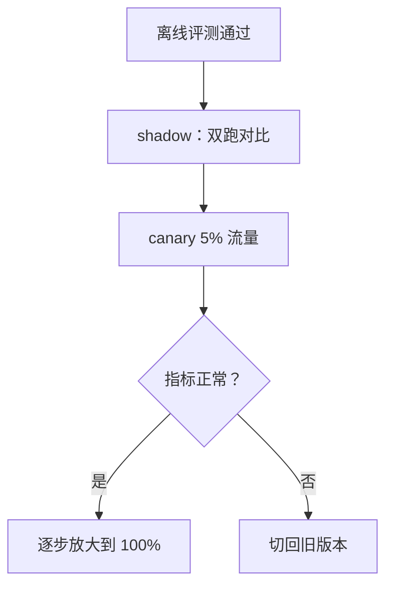

## Q
**Canary 与 shadow traffic · 模型和 prompt 怎么灰度**｜实践 · 必会

要把线上模型从 A 换到更便宜的 B。离线评测 B 不差，但你仍然不放心。怎么上线？

## A
**两种手段：**

| | canary | shadow traffic |
|---|---|---|
| 做法 | 把一小部分真实用户**路由到新版本**，逐步放大 | 把线上请求**复制一份**发给新版本，**结果不返回用户** |
| 用户看到 | 新版本的输出 | 仍然是旧版本的输出 |
| 风险 | 小部分用户受影响 | 没有用户风险，但成本翻倍 |
| 看什么 | 用户信号、线上指标 | 与旧版逐条对比（双跑对比），用 judge 或规则打分 |

**canary 要点（Fowler）：**
- 选择用户的方式：随机抽样、先给内部员工、按用户特征或地区；
- 回滚就是把流量重新路由回旧版本；
- 需要同时维护多个版本，复杂度增加，所以并行版本数要少；
- 与 A/B 测试不同：A/B 是验证假设，可能要几天才有统计显著性；canary 应在几分钟到几小时内结束。

**自动回滚条件要事先写好：** 例如格式错误率、拒答率、工具错误率、p95 延迟、每请求成本超过阈值；点赞率这类慢信号用来事后复核。

**注意：** 流量太小时，质量指标的噪声大，要先估所需样本量（见 statistical power 那张卡）。prompt 变更和模型变更都应该走同一条发布流程，并在 trace 里记录版本号。

出处

Fowler《CanaryRelease》martinfowler.com/bliki/CanaryRelease.html（2026-11-21 读）；shadow traffic 为通用发布实践

