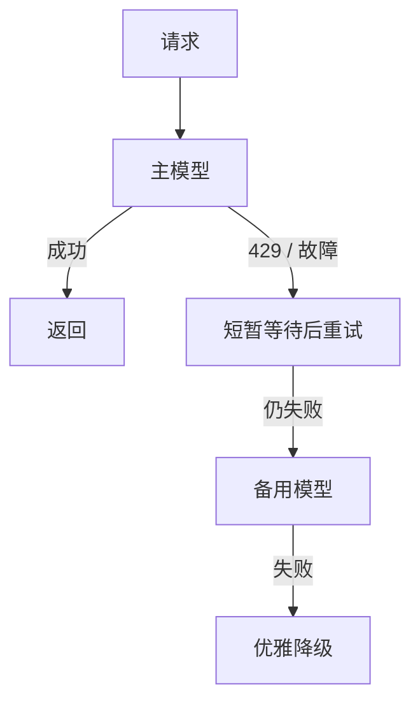

## Q
**LLM gateway · 多供应商回退怎么设计**｜实践 · 必会

主供应商的 API 一个下午内多次返回 429 和超时。设计 gateway 的回退，要注意什么？

## A
**回退顺序：**

| 要点 | 做法 |
|---|---|
| **区分错误** | 限流、超时、5xx 可以重试或回退；4xx 的请求本身有问题不要回退 |
| **备用模型要评测过** | 不同模型对同一个 prompt 表现不同（有自己的怪癖）。切换后质量可能下降，**备用路径也要在评测集上测过**，且 prompt 可能要另一版 |
| **能力对齐** | 备用模型要支持你用到的功能：function calling、structured outputs、context 长度、logprobs |
| **上下文长度** | 备用模型上限更小就要截断（或选择更大的） |
| **标记来源** | 日志和 trace 里记录**实际响应的模型**，否则漂移排查会混乱 |
| **熔断** | 主供应商持续失败，暂时整体切走，隔一段再探测恢复 |
| **成本** | 备用模型的价格不同，预算与告警要涵盖 |
| **隐私与合规** | 备用供应商也要满足数据驻留和隐私要求（见 build vs buy 那张卡） |

**书里的补充：** 同一个模型通过不同的 API 提供时，表现可能有细微差异，因为各 API 的优化不同，换 API 时要彻底测试。

**出处：** Huyen《AI Engineering》ch10 §Gateway（fallback policies）；ch4 §Open source models versus model APIs（不同 API 的细微差别）。熔断与评测备用路径为通用的可靠性做法
