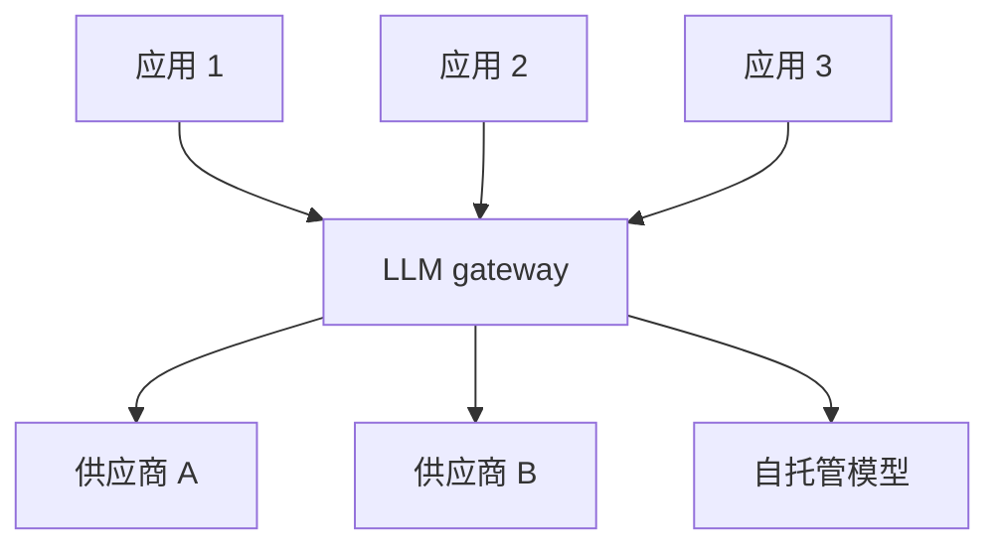

## Q
**LLM gateway 的职责**｜摘要 · 必会

三个团队各自直接调用 model 供应商的 API，每人手里都有一把 API key。为什么要在中间加一个 gateway？它要承担什么？

## A
**一句话：** model gateway 是组织与各种模型之间的**统一、安全的中间层**。

| 职责 | 说明 |
|---|---|
| **统一接口** | 自托管模型和商业 API 用同一个接口；供应商 API 变了只改 gateway，不用改所有应用 |
| **Key 管理与访问控制** | 不把组织的 API key 发给每个人（容易泄露），只给 gateway 的访问权；细粒度控制哪个用户或应用能用哪个模型 |
| **成本管理** | 监控并限制 API 调用的使用量，防止滥用 |
| **Rate limit 与 fallback** | 主 API 被限流或故障（"不幸很常见"）时，路由到备用模型、等一下重试，或优雅降级 |
| **日志、审计、分析、负载均衡** | 请求和响应都经过这里，适合顺带做 |
| **缓存、guardrails** | 有的 gateway 也提供 |

**为什么应用不该直连供应商：**
- key 到处都是，泄露了难以收回；
- 换模型或加供应商要改每一个应用；
- 没有统一的限流、成本统计和审计；
- 故障回退要每个应用自己写。

**简单实现：** 一个封装各家 SDK 的统一接口加路由（书里给了一个不含错误处理与优化的示意）；现成的有 Portkey、MLflow AI Gateway、Kong、Cloudflare 等。

出处

Huyen《AI Engineering》ch10 §Step 3 → Gateway

