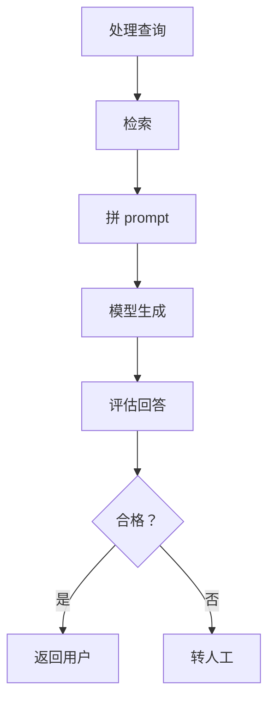

## Q
**Orchestration 与 pipelines**｜摘要 · 必会

一个应用要依次做：处理查询、检索、拼 prompt、调模型、评估回答、不合格转人工。这一串步骤怎么组织？要不要上编排框架？

## A
**Orchestrator 做两件事：**

| 步骤 | 内容 |
|---|---|
| **Components definition** | 告诉它系统用到哪些组件：模型、检索用的数据源、tool；评测和监控工具 |
| **Chaining** | 按顺序把组件串起来（函数组合）：从收到查询到完成任务的每一步 |

**要求：**
- 在步骤之间传递数据，并确保**当前步骤的输出符合下一步期望的格式**；
- 组件失败或数据不匹配时能**通知你**；
- 延迟要求严格时，**尽量并行**：如路由组件和 PII 去除组件可同时做。

**注意：** AI 流水线的编排器**不同于**通用的工作流编排器（如 Airflow、Metaflow）。常见的 AI 编排工具有 LangChain、LlamaIndex、Flowise、Langflow、Haystack；检索与 tool 使用很常见，所以很多 RAG 和 agent 框架也是编排工具。

**要不要用：** **先不用**。任何外部工具都增加复杂度，可能把关键细节抽象掉，让系统难以理解和调试；后期再判断是否需要。

**评估编排器的三方面：** 集成与扩展性、对复杂流水线的支持（分支、并行、错误处理）、易用性 / 性能 / 可扩展性（避免隐藏的 API 调用和额外延迟）。

出处

Huyen《AI Engineering》ch10 §AI Pipeline Orchestration

