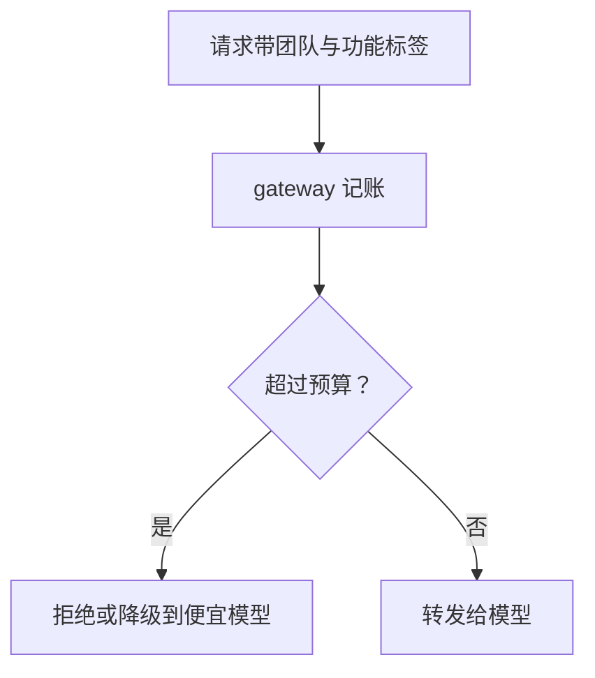

## Q
**Multi-tenant · quota、budget 与 cost attribution**｜摘要 · 必会

平台有 5 个团队、20 个功能共用一个 gateway。月底账单暴涨，没人知道是谁用的。怎么提前设计？

## A
**三个概念：**

| 概念 | 是什么 |
|---|---|
| **Cost attribution（成本归属）** | 每次调用都带上**团队、功能、用户**等标签，月底按标签汇总，知道谁花了多少 |
| **Quota（配额）** | 限制某个团队、应用或用户在一段时间内能用多少（请求数、token 数） |
| **Budget（预算）** | 金额上限；接近上限告警，**超出就熔断或降级** |

**怎么做：**
1. 所有调用经过 gateway，**强制**带标签（没有标签的请求不放行）；
2. 记录每次调用的**输入、输出 token 数和模型**，再按价格表换算成金额；
3. 按团队、功能配置 quota 和 budget：软阈值（80% 告警）和硬阈值（拒绝）；
4. 看板展示：每个团队每个功能的 token 和费用趋势、缓存命中率；
5. 对用户级别也限流，防止被滥用（OWASP 的 Unbounded Consumption）。

**书里的依据：** gateway 提供**访问控制和成本管理**：监控和限制 API 调用的使用量，防止滥用，并管理成本；并可指定哪个用户或应用能访问哪个模型。

**出处：** Huyen《AI Engineering》ch10 §Gateway（access control and cost management）；ch10 §Metrics（跟踪 token 数与成本）。标签、预算熔断的具体做法为通用的平台做法
