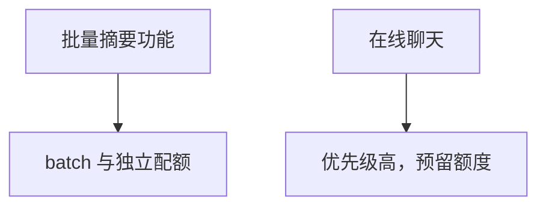

## Q
**Multi-tenant · 一个功能把预算吃光了**｜考点 · 必会

团队 A 的"文档批量摘要"功能一夜之间用掉了整个月 70% 的预算，影响了同一个 gateway 上团队 B 的在线聊天。怎么防止这类事故，事后怎么定位？

## A
**防：**

| 措施 | 效果 |
|---|---|
| **每团队 / 每功能的 quota** | 一个功能再多请求，也只能用到它的配额；不会挤占别人 |
| **预算的软硬阈值** | 80% 告警，100% 拒绝或降级；关键业务单独预留 |
| **按优先级排队** | 在线请求优先，批量请求走 batch API 或低峰排队 |
| **限制并发与单个请求大小** | 防止一个请求过大、一个循环无限调用 |
| **agent 的 max steps 与 budget** | 每个任务有上限（见 agent loop） |

**定位：** 按标签看用量：哪个团队、哪个功能、哪个模型、哪个时间段；对比 token 数的变化（输入还是输出暴涨）；再回到 **trace** 看具体请求，通常是循环重试、超长文档或错误的批量任务。

**修复后：** 给这类场景加告警（单位时间内的 token 增速）和回归检查。

**批量任务应放进 batch API：** 文档摘要不需要即时返回，用 batch API 成本更低、也不抢在线容量（见 Batch API 那张卡）。

出处

Huyen《AI Engineering》ch10 §Gateway（usage limits）；ch9 §Online and batch inference APIs。配额与优先级设计为通用的平台做法

