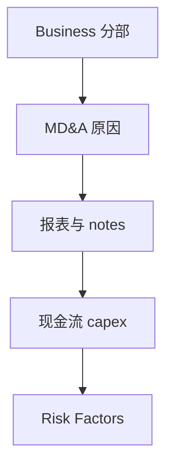

## Q
**10-K 阅读顺序**｜怎么读 · 必会

第一次打开一家 AI 相关公司的 10-K（美国上市公司每年向 SEC 提交的年度报告；10-Q 是每季度一份），这几百页该按什么顺序读？

## A
**顺序（先问题后细节）：**

| 步 | 读哪里 | 找什么 |
|---|---|---|
| 1 | Business | 公司靠什么赚钱，分几个 segment（业务分部） |
| 2 | MD&A | 管理层解释收入、毛利为什么变 |
| 3 | 财务报表 + notes | 收入分部、**RPO**（已签约未确认收入）、**customer concentration**（客户集中度） |
| 4 | Cash flow statement | 经营现金流、capex（买设备的钱） |
| 5 | Notes：PP&E | **折旧年限**（useful life）：设备按几年摊销，年限越长，每年利润越好看 |
| 6 | Risk Factors | 公司自己承认的最大风险（出口管制、供应集中等） |

**每行都问：** 这个数比上年变了多少？公司自己怎么解释？有没有一次性项目？

出处

SEC 对 10-K / 10-Q 的通用结构（https://www.sec.gov）；NVIDIA FY2026 10-K 的章节编排。

