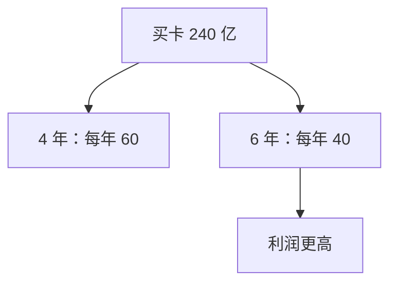

## Q
**折旧年限的影响**｜考点 · 追问

两家云公司买了同样的 GPU，一家把它们按 4 年折旧，另一家按 6 年。同样的收入下，谁的利润更高？为什么这个假设值得在 10-K 里专门找？

## A
**演算（假设数字，仅演示）：** 一批 GPU 花了 240 亿美元。

| 折旧年限 | 每年折旧 | 对利润的影响 |
|---|---|---|
| 4 年 | 60 亿美元 | 费用大，利润低 |
| 6 年 | 40 亿美元 | 费用小，利润高 20 亿美元 |

折旧（depreciation）是把设备成本平摊到使用年限里的会计做法，是**估计**，不是现金支出。现金在买的那天就花掉了。

**为什么要找：**
- 年限由管理层定，改年限不用花一分钱，却能直接改变利润。
- 如果芯片每一两年就换代，长年限可能高估利润。

**怎么读：** 在 10-K 的 PP&E（property, plant and equipment，固定资产）附注里找 servers/equipment 的 useful life；比较前后几年有没有改动。

出处

通用会计准则（直线折旧）；数字为演示用。

