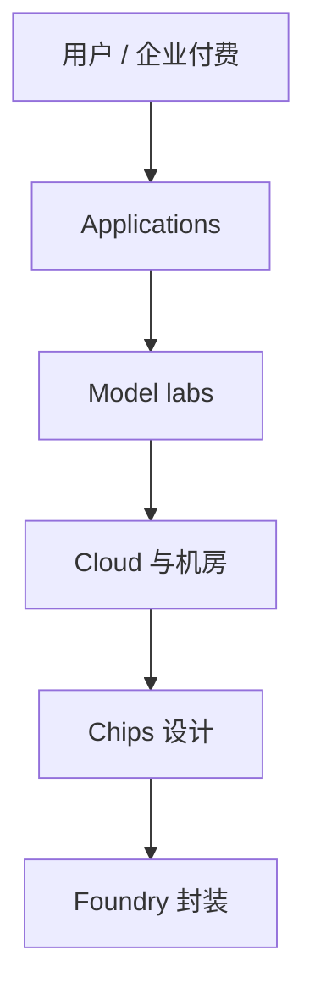

## Q
**Value chain · 五层**｜先修 · 必会

一家公司在 ChatGPT 类产品里发一条消息，钱最后分给了谁？AI 行业的 value chain（价值链：从原料到终端产品，每一层把钱付给上一层）有哪五层，每层卖什么？

## A
**一句话：** 终端用户或企业付的钱，自上而下一层层分出去，最后大头流向芯片设计公司、云厂商和模型公司。

| 层 | 卖什么（一句话定义） | 付钱的是 | 例子 |
|---|---|---|---|
| 5 Applications | 面向用户的产品（聊天、编程助手） | 用户、企业 | ChatGPT、编程助手 |
| 4 Model labs | 训练并出租模型（model lab：训练大模型的公司） | 应用、企业、用户 | OpenAI、Anthropic、Google DeepMind |
| 3 Cloud 与 data center | 出租算力；data center（放几万块芯片的专用机房）；hyperscaler（超大规模云厂商，如 Microsoft、Amazon、Alphabet、Meta 这几家） | model lab、应用 | AWS、Azure、Google Cloud |
| 2 Foundry 与 packaging | foundry（代工厂，按设计图制造芯片）；packaging（把计算芯片和显存封装成一块能用的卡） | 芯片设计公司 | TSMC（最大的先进芯片代工厂） |
| 1 Chips | 芯片设计：GPU（图形处理器，现在是 AI 计算的主力）及定制芯片 | hyperscaler、model lab | NVIDIA、AMD |

**两个词先记住：**
- **Training（训练）**：用海量数据把模型一次性「教出来」，成本巨大，一次性发生。
- **Inference（推理）**：模型每次回答用户时的计算，每次请求都要付，用量越大成本越高。

**出处：** Stanford HAI, AI Index Report 2025（https://hai.stanford.edu/ai-index/2025-ai-index-report）的产业分层；层级划分为本卡作者归纳，非报告原文。
