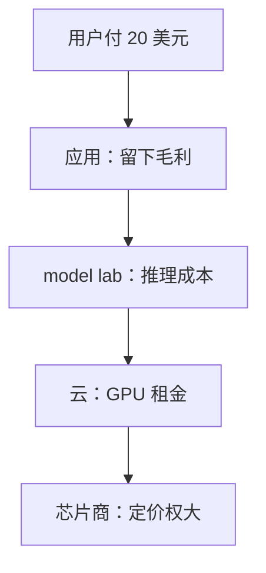

## Q
**Value chain · 追钱**｜考点 · 必会

有人说「AI 应用公司收 20 美元一个月，所以 AI 行业的钱都在应用层」。用 value chain 说明这句话错在哪，你会去哪几层找真正的收入？

## A
**错在：** 用户付的钱是**收入**，不是**利润**；它在往下分的路上被每一层的成本和定价权切走。

**三步追钱法：**
1. 一次请求的成本由谁收：应用付给 model lab（按 token 计费；token 是模型处理文字的最小单位，约 3/4 个英文词），model lab 再付给云（租 GPU 小时），云再付给芯片商和 foundry。
2. 每层看**谁有定价权**：供给少的层（先进芯片、先进 packaging、显存）收得多；竞争激烈的层（应用）被挤。
3. 读财报验证：NVIDIA 2026 财年（截至 2026 年 1 月 25 日）收入 2159 亿美元，其中 data center 约 1937 亿美元（数据取自 NVIDIA 2026-02 财报新闻稿）。芯片层的收入已经在这个量级，说明钱在往下游集中。

**记法：** 问「这层有几家供应商，换一家难不难」，越难换的层越能留住钱。

出处

NVIDIA Q4 与 FY2026 财报新闻稿（investor.nvidia.com, 2026-02）；AI Index 2025 产业章节。

